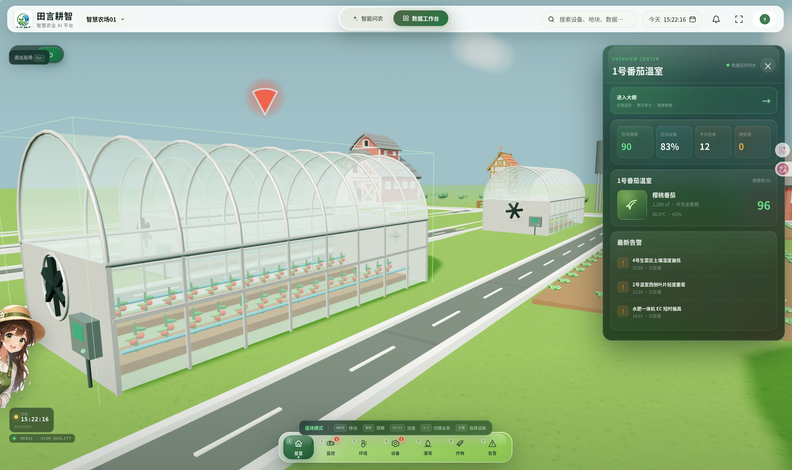
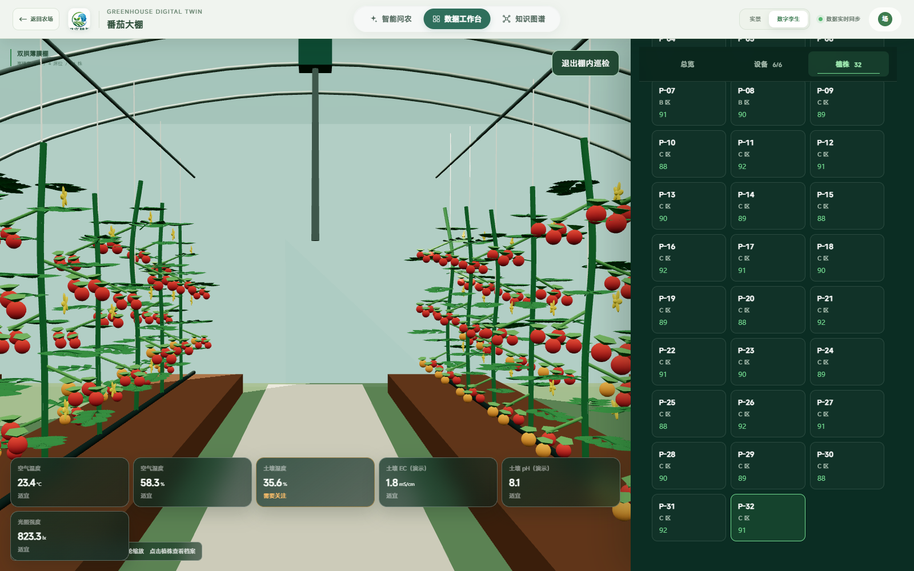
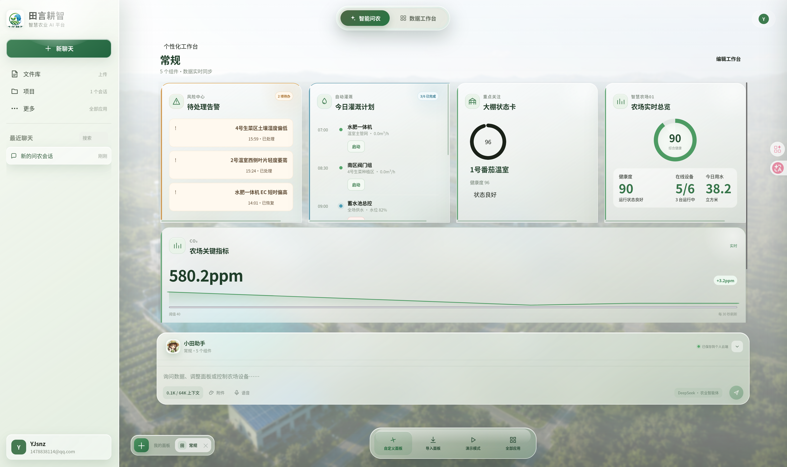
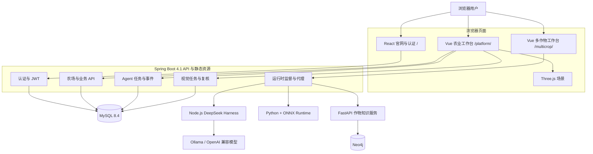

# 盐田丰语｜智慧农业与数字化农场平台

盐田丰语是面向农业展示、业务记录和本地 AI 验证的全栈项目。仓库包含 React 官网、Vue 农业工作台、Three.js 数字孪生、作物视觉、农业 Agent、多作物知识服务、串口网关示例和 Jetson 部署工具。

项目定位是**可运行的软件演示版与工程验证平台**。农场观测与设备状态包含演示数据，控制操作保存的是软件回执；梨叶模型给出的是待复核视觉候选；知识和 Agent 输出用于信息检索与任务展示。这些结果都不等同于真实农事测量、专业植保诊断或硬件已经执行。

## 目录

- [项目预览](#项目预览)
- [功能与实现状态](#功能与实现状态)
- [系统架构](#系统架构)
- [技术栈](#技术栈)
- [快速开始](#快速开始)
- [配置说明](#配置说明)
- [开发与构建](#开发与构建)
- [主要 API](#主要-api)
- [数据与持久化](#数据与持久化)
- [仓库结构](#仓库结构)
- [安全边界与已知限制](#安全边界与已知限制)
- [部署与项目文档](#部署与项目文档)
- [许可证与外部服务](#许可证与外部服务)

## 项目预览

### 官网


官网提供产品介绍、解决方案、数字孪生介绍、登录注册和平台入口。

### 农业工作台


工作台以基地为上下文，呈现地块、温室、设备、气象和告警。地图对象与详情面板联动，可进入农事、环境、设施、灌排、告警和采后追溯等业务。

### 数字孪生




场景支持鸟瞰、对象选择、业务定位和漫游。不同基地有相应场景；部分地块、道路和作物模型是程序化或概念表达，不是测绘成果。

### 作物与采后业务



工作台可登记农事、生长观察和采收批次。批次沿采收、分选、入库、出库顺序追加事件，可在详情中查看完整轨迹和二维码分享摘要。

### 智能问农与工作台




智能问农保留原对话工作台；新 Agent 工作流会展示任务状态、调用工具、事件、来源和结果，并支持继续追问、重试、取消和导出。

## 功能与实现状态

| 模块 | 当前实现 | 运行方式与边界 |
|---|---|---|
| 官网与账号 | 产品页面、注册、密码登录、JWT 会话、人脸绑定与解绑界面 | React；百度人脸 API 密钥可选，未配置时不提供有效云端人脸服务 |
| 农场数据工作台 | 基地概览、地块与温室、环境指标、设备、灌排、告警、观测历史 | Vue；初始化数据和周期更新是演示数据，控制写入数据库但不连接真实执行器 |
| 农事与生长 | 新增农事记录、生长观察，按基地和地块查看业务记录 | 保存于 MySQL，属于演示基地的共享业务记录 |
| 采后批次追溯 | 采收批次登记、分选/入库/出库逐步流转、版本约束、二维码只读摘要 | 每一步记录为新的业务事件；数量和流转是人工录入的演示数据 |
| 数字孪生 | 农场、果园和温室场景，地图/对象联动、对象详情和漫游 | Three.js；场景几何和概念坐标不代表实测 GIS 或导航地图 |
| 农业 Agent | Harness 运行时、工具白名单、任务历史、事件、取消、重试、追问和导出 | Node.js 子进程连接 Ollama 或兼容 API；工具读取共享演示农场及已保存记录 |
| 农业知识与旧问答 | 关键词资料检索、上下文组装和 DeepSeek 服务端代理 | 不是向量检索或 GraphRAG；在线 DeepSeek Key 仅放服务端环境变量 |
| 梨叶视觉 | 上传 PNG/JPEG、ONNX/TensorRT 推理、检测历史、原图查看与人工复核 | Windows 默认 ONNX CPU；Jetson TensorRT 可选 CUDA 预处理/NMS 与 nvImageCodec JPEG 解码，均须逐机型验收；模型未通过泊头鸭梨独立诊断精度验收 |
| 多作物研判 | 小麦、梨、小枣和设施蔬菜知识/研判服务与前端 | FastAPI、Neo4j 及作物专属流程；不同作物的模型/证据成熟度不同，番茄视觉未完成 |
| 串口网关 | TY Serial v1 报文、SQLite 缓存、去重与命令/回执接口示例 | `embedded/` 下的固件及网关属于集成示例，尚未完成真实厂家设备联调 |
| Jetson 部署 | Orin Nano 目标环境安装、TensorRT 构建及 systemd 脚本 | 需目标板单独验证 JetPack、模型、内存、性能和服务组合 |

### Agent 当前工具

当前 Harness 工具包括：

- `get_farm_context`：读取共享演示农场当前指标、地块、设备和告警；
- `get_business_records`：读取农事、生长、批次、灌排和告警模拟回执摘要；
- `retrieve_evidence`：按关键词检索资料并返回来源；
- `analyze_environment`：按已配置阈值核对当前指标和已保存观测；不计算病害概率；
- `query_crop_knowledge`：请求多作物知识服务；
- `get_vision_records`：读取当前用户已保存的梨叶视觉记录；不触发新推理。

任务和工具事件保存到 MySQL。视觉记录按当前登录用户隔离；农场业务记录为演示基地共享记录。模型回答不代替现场核验或农业专业意见。

## 系统架构



### 页面与后端的挂载关系

| 页面或服务 | 地址 | 源码 | 构建输出 |
|---|---|---|---|
| React 官网、账号页 | `/` | `landing/` | `src/main/resources/static/` |
| Vue 农业工作台 | `/platform/` | `frontend/` | `src/main/resources/static/platform/` |
| Vue 多作物工作台 | `/multicrop/` | `vision-frontend/` | `src/main/resources/static/multicrop/` |
| REST API | `/api/**` | `src/main/java/com/example/ty/` | Spring Boot 应用 |

Spring Boot 同源托管页面和 API。作物视觉工作台位于农业平台业务流程内，使用 `/api/vision/**`；`vision-runtime/` 是 Python 推理运行时，不是单独的 Web 前端。

### 运行时调用链

```text
浏览器 ──同源 HTTP──> Spring Boot ──JPA/JDBC──> MySQL
                         ├──本地进程协议──> Node.js Harness ──HTTP──> 模型服务
                         ├──本地 JSON/进程──> Python 梨叶 ONNX 推理
                         └──HTTP 代理/监督──> FastAPI Multi-crop ──> Neo4j
```

主应用监督本地 Multi-crop worker；若配置的是远程 URL，则复用远程服务，不会启动或停止该服务。Neo4j 和 Python 依赖由初始化任务准备，首次完整启动会根据本机配置安装。

## 技术栈

| 层 | 主要技术 | 目录 |
|---|---|---|
| 官网 | React 18、React Router、Vite、Tailwind CSS | `landing/` |
| 农业平台 | Vue 3、TypeScript、Pinia、Vue Router、ECharts、Sass、Vite | `frontend/` |
| 多作物工作台 | Vue 3、Axios、Vite | `vision-frontend/` |
| 三维图形 | Three.js、WebGL、GLTF/GLB、本地资源 | `frontend/`、`frontend/public/assets/` |
| 后端 | Java 17、Spring Boot 4.1、Spring MVC、Spring Data JPA、Hibernate | `src/main/java/` |
| 登录 | JWT（JJWT）、BCrypt（Spring Security Crypto）、自定义 MVC 拦截器 | `src/main/java/com/example/ty/auth/` |
| Agent | Node.js 24+、DeepSeek Harness SDK、农业白名单插件 | `agent-runtime/`、`src/main/java/.../agent/` |
| 视觉 | Python 3.11、NumPy、Pillow、ONNX Runtime CPU；Jetson 可选 TensorRT、CUDA 和 nvImageCodec | `vision-runtime/`、`src/main/java/.../vision/` |
| 多作物知识服务 | Python、FastAPI、Neo4j；各诊断流程有独立依赖 | `ai-service/` |
| 数据库 | MySQL 8.4、MySQL Connector/J、HikariCP | Docker、本地环境配置 |
| 边缘 | Docker Compose、systemd、TensorRT/Jetson 脚本 | `deploy/jetson/` |

官网和两个 Vue 应用各有 npm lockfile。请在正常依赖安装时用 `npm ci`，不要只复制 `node_modules`。

## 快速开始

### 环境要求

主项目启动脚本面向 Windows 10/11，支持 Windows PowerShell 5.1 和 PowerShell 7。

| 依赖 | 版本/用途 | 必需情况 |
|---|---|---|
| JDK（含 `javac`） | 17+，运行 Spring Boot 与 Maven Wrapper | 必需 |
| Node.js 与 npm | Node 24+，构建三套前端及运行 Harness | 必需 |
| Docker Desktop | Linux 容器模式，运行 MySQL 与 Neo4j | 默认本地数据库必需；外部数据库可不使用 Docker |
| Python | 3.11，梨叶模型及 Multi-crop 服务依赖 | 首次完整准备需要 |
| Ollama 或兼容模型 API | 提供 Agent 模型推理 | Agent 功能需要；本地 Ollama 是默认配置 |
| 网络 | 下载 Maven/npm/Python 包、容器镜像和首次模型权重 | 首次部署需要 |

首次安装可能下载较大的语言模型、梨叶训练权重、Neo4j 镜像和多作物检索资源。请为模型文件和 Docker 数据卷预留空间。

### 启动完整开发环境

1. 启动 Docker Desktop，并确认 Docker 使用 Linux 容器。
2. 在项目根目录执行：

```powershell
.\start.cmd
```

也可以双击根目录的 `start.cmd`。入口依次检查 JDK/Node/Docker，准备 MySQL，检查或安装 Agent 模型，准备梨叶视觉及 Multi-crop Python 环境，构建 `landing`、`frontend` 和 `vision-frontend`，再通过 Maven Wrapper 启动 Spring Boot。

启动后的常用地址：

| 页面/接口 | 地址 |
|---|---|
| 官网 | `http://localhost:8081/` |
| 农业工作台 | `http://localhost:8081/platform/` |
| 多作物工作台 | `http://localhost:8081/multicrop/` |
| 系统健康 | `http://localhost:8081/api/health` |
| 运行能力状态 | `http://localhost:8081/api/system/status` |
| Multi-crop 本地 API | `http://127.0.0.1:8090/` |
| Neo4j HTTP | `http://127.0.0.1:7474/` |

按 `Ctrl+C` 停止 Spring Boot。Docker 数据库与图数据库容器按 restart policy 运行；停止主应用不会删除数据库或卷。首次启动后可在官网注册账号，再进入工作台。

### 单一入口与维护命令

根目录的 `start.cmd` 是主项目唯一启动和运维命令入口。底层脚本集中在 `scripts/`，请通过入口选择任务：

```powershell
.\start.cmd -Help

# 主应用
.\start.cmd                         # 检查依赖、准备环境、构建并启动
.\start.cmd -SkipBuild              # 使用现有前端构建和依赖启动
.\start.cmd -ExternalDatabase       # 连接已有数据库（需 DB_URL）
.\start.cmd -Check                  # 启动前检查并准备本地数据库
.\start.cmd -Cpu                    # 以本地 Ollama CPU 模式准备默认 Agent 模型

# 数据与质量检查
.\start.cmd -Task Backup
.\start.cmd -Task Restore -BackupFile 'D:\u005cbackups\snapshot.zip' -TargetDatabase agric_restore
.\start.cmd -Task Test

# 模型与独立服务
.\start.cmd -Task AgentSetup -CheckOnly
.\start.cmd -Task AgentSetup -Cpu
.\start.cmd -Task VisionSetup -RebuildModel
.\start.cmd -Task MultiCropSetup -InitializeKnowledge
.\start.cmd -Task MultiCrop

# 发行包（使用已有 JAR；不会替你重建 JAR）
.\start.cmd -Task Release
.\start.cmd -Task Release -IncludeMultiCrop
.\start.cmd -Task JetsonRelease
.\start.cmd -Task JetsonRelease -IncludeMultiCrop
```

`-SkipBuild` 适用于源码和依赖已准备好的环境，不会为全新环境补装前端依赖、模型和构建产物。发行任务打包 `target/ty-0.0.1-SNAPSHOT.jar`，执行前应自行完成需要的构建。

### 首次运行数据库

Windows 启动器默认创建或启动 MySQL 8.4 容器：

| 设置 | 默认值 |
|---|---|
| 容器 | `agric-mysql` |
| 宿主机端口 | `3307`，只绑定本机 |
| 数据库 | `tianyan` |
| 用户 | `root` |
| 本地演示密码 | `Root_123456` |
| Docker 数据卷 | `agric-mysql-data` |

这些默认密码只适合本机演示。脚本不会删除或重置同名数据库卷；已有容器的端口映射和 MySQL 密码必须与本机配置一致。

连接已经准备好的数据库：在 `.env.local` 设置 `DB_URL`、`DB_USERNAME`、`DB_PASSWORD`，然后执行 `start.cmd -ExternalDatabase`。此模式不创建 Docker MySQL；数据库须预先创建并允许应用账号连接。

## 配置说明

### 创建本地配置

首次配置可复制示例：

```powershell
Copy-Item .env.example .env.local
```

`.env.local` 已被 Git 忽略。配置读取支持注释、空行、`KEY=VALUE` 和成对引号。密钥、数据库密码和实际个人数据不要提交到仓库。

### 常用环境变量

| 变量 | 默认/用途 | 说明 |
|---|---|---|
| `SERVER_PORT` | `8081` | Spring Boot HTTP 端口 |
| `SERVER_ADDRESS` | `0.0.0.0` | 服务绑定地址；如需仅本机开放，可配置为 `127.0.0.1` |
| `DB_URL` | Windows 启动器自动生成 3307 JDBC URL | 外部数据库模式必须设置 |
| `DB_USERNAME` / `DB_PASSWORD` | `root` / 演示值 | 生产或共享环境应使用最小权限账号和强密码 |
| `DB_NAME` | `tianyan` | 本地数据库名，仅允许字母、数字和下划线 |
| `MYSQL_CONTAINER` | `agric-mysql` | Docker MySQL 容器名 |
| `MYSQL_PORT` | `3307` | MySQL 映射到宿主机的端口 |
| `MYSQL_IMAGE` | `mysql:8.4` | MySQL 容器镜像 |
| `MYSQL_VOLUME` | `agric-mysql-data` | MySQL 持久化卷 |
| `JWT_SECRET` | 本地演示默认值 | 部署环境设置独立且至少 32 字节的随机值 |
| `AGENT_BASE_URL` | `http://127.0.0.1:11434/v1` | Ollama 或其他 OpenAI 兼容接口 |
| `AGENT_MODEL` | `qwen2.5:7b` | 必须与模型服务可用模型名称相同 |
| `AGENT_API_KEY` | 空 | 远程兼容服务可在此配置；留空时本地 Ollama 不带密钥 |
| `AGENT_ENGINE` | `harness` | Agent 引擎选择；legacy 仅作兼容路径 |
| `AGENT_WORKERS` / `AGENT_CAPACITY` | `2` / `4` | Agent 并发工作线程和总容量 |
| `AGENT_CONTEXT_TOKENS` / `AGENT_MAX_TOKENS` | `4096` / `768` | Agent 上下文和单次生成预算；云端示例使用 16K 上下文和 1K 输出预算，并投影长工具结果以避免上下文溢出 |
| `DEEPSEEK_API_KEY` | 空 | 旧问农 DeepSeek 服务端调用密钥，可选 |
| `DEEPSEEK_BASE_URL` / `DEEPSEEK_MODEL` | 官方兼容地址 / 项目默认模型 | 在线问农的服务端模型配置 |
| `BAIDU_FACE_AK` / `BAIDU_FACE_SK` | 空 | 百度人脸识别服务密钥，可选 |
| `VISION_STORAGE` | `var/vision` | 用户视觉原图及运行记录文件目录 |
| `VISION_BACKEND` | `onnx-cpu` | 当前 Windows/桌面默认 ONNX CPU 后端 |
| `VISION_TIMEOUT_SECONDS` | `120` | Java 到 Python 推理请求等待上限 |
| `MULTICROP_BASE_URL` | `http://127.0.0.1:8090` | 本地或远程 Multi-crop API 地址 |
| `MULTICROP_AUTO_START` | `true` | 主应用管理本地 worker 时是否自动启动和监督 |
| `MULTICROP_PYTHON` | 项目内视觉 Python 虚拟环境 | 可指定 Python 解释器路径 |
| `NEO4J_HTTP_URL` / `NEO4J_PASSWORD` | 本机 Neo4j / 初始化配置 | Multi-crop 图谱服务连接配置 |
| `WEATHER_LATITUDE` / `WEATHER_LONGITUDE` | 泊头区域坐标 | 区域天气参考坐标，不是演示地块测绘位置 |
| `AUTH_REGISTRATION_ENABLED` | `true` | 是否开放账号注册 |

完整模板和额外参数见 [`.env.example`](.env.example)、[Windows 启动指南](docs/windows.md) 与 [Jetson 环境示例](deploy/jetson/.env.example)（若发行包中未包含则查看 `deploy/jetson/` 配置模板）。

## 开发与构建

### 前端单独开发

三套前端各自安装依赖并启动 Vite。每个服务在独立终端运行：

```powershell
# 官网，默认 http://localhost:5174/
cd landing
npm ci
npm run dev

# 农业工作台，默认 http://localhost:5173/platform/
cd frontend
npm ci
npm run dev
npm run typecheck
npm run build

# 多作物工作台，Vite 端口 5175，页面 base 为 /multicrop/
cd vision-frontend
npm ci
npm run dev
npm run build
```

`landing` 开发服务器端口为 5174，`frontend` 为 5173，`vision-frontend` 为 5175。三个服务需在不同终端启动。官网和农业平台的 `/api` 代理默认指向 `http://localhost:8081`。若后端改端口，前端可设置 `VITE_API_TARGET`。

React 官网构建到 `src/main/resources/static/` 根目录，不会清空相邻平台资源；农业平台输出到 `static/platform/`，多作物应用输出到 `static/multicrop/`。这些目录是生成物，请编辑各自源码而非手改构建产物。

### 后端构建与运行

```powershell
# 仅运行 Spring Boot 测试（建议使用 start.cmd 以创建隔离测试库）
.\start.cmd -Task Test

# Maven Wrapper 打包
.\mvnw.cmd package

# 使用 start.cmd 正常准备运行时并启动整个应用
.\start.cmd
```

独立执行 `mvnw.cmd spring-boot:run` 需要自行准备 MySQL、Node Agent 依赖、Python 视觉环境以及可选 Multi-crop 服务。测试脚本会创建/使用独立 `tianyan_test`，避免写入演示库；外部测试库可由 `TEST_DB_URL`、`TEST_DB_USERNAME` 和 `TEST_DB_PASSWORD` 配置。

### Python 作物服务

`ai-service/` 包含多个作物诊断、知识图谱、向量资料和评估子项目，依赖因子项目而异。主项目的 `start.cmd` 会为集成 Multi-crop worker 使用视觉虚拟环境，并按需要运行 `setup-multicrop` 初始化。独立开发或研究某个作物时，应先阅读该目录自己的 README 和 requirements 文件，不建议把所有 Python 依赖混装到一个全局解释器。

### 本地梨叶模型

Windows 首次启动会使用 Python 3.11 创建 `vision-runtime/.venv`，安装运行依赖；如果本地 ONNX 模型/清单不存在，会下载固定上游权重并导出 ONNX。单独准备或重建：

```powershell
.\start.cmd -Task VisionSetup
.\start.cmd -Task VisionSetup -RebuildModel
```

上传仅接受 PNG/JPEG，最大 8 MB、2000 万像素。任务进入有界队列，原图放到 `VISION_STORAGE`，识别结果和复核记录保存在数据库。模型训练来源和转换许可需参见视觉文档与模型许可证文件。

### Agent 模型

本地默认模型为 Ollama 中的 `qwen2.5:7b`。正常启动会检查模型服务，并在配置指向本地 Ollama 且模型缺失时拉取模型。机器显存或资源不适合 GPU 推理时：

```powershell
.\start.cmd -Task AgentSetup -Cpu
```

然后在 `.env.local` 设置：

```dotenv
AGENT_MODEL=agric-qwen2.5:7b-cpu
```

也可设置 `AGENT_BASE_URL`、`AGENT_MODEL` 和 `AGENT_API_KEY` 接入兼容 OpenAI API 的远程模型。服务端需能访问该地址，密钥不会传入浏览器构建产物。

## 主要 API

所有非公开业务 API 通过 JWT 认证，请求头形式为：

```http
Authorization: Bearer <JWT>
```

### 认证与状态

| 方法 | 路径 | 说明 |
|---|---|---|
| `POST` | `/api/auth/register` | 注册 |
| `POST` | `/api/auth/login` | 邮箱密码登录 |
| `GET` | `/api/auth/me` | 当前会话用户 |
| `POST` | `/api/auth/face-register` | 登录用户绑定人脸（multipart `photo`） |
| `POST` | `/api/auth/face-delete` | 解绑人脸 |
| `POST` | `/api/auth/face-login` | 人脸识别登录（multipart `photo`） |
| `GET` | `/api/health` | Spring Boot 存活状态 |
| `GET` | `/api/system/status` | 模型、视觉和演示业务能力状态 |

### 农场工作台与业务

| 方法 | 路径 | 说明 |
|---|---|---|
| `GET` | `/api/farms/{farmId}/dashboard` | 基地仪表盘快照 |
| `GET` | `/api/farms/{farmId}/greenhouses/{greenhouseId}` | 温室详情 |
| `GET` | `/api/farms/{farmId}/observations?metricKey=soilMoisture` | 指标历史，最多返回最近 240 个点 |
| `POST` / `PUT` / `DELETE` | `/api/farms/{farmId}/devices[/{entityId}]` | 设备资料维护 |
| `PATCH` | `/api/farms/{farmId}/devices/{entityId}` | 设备模拟控制 |
| `POST` | `/api/farms/{farmId}/devices/{entityId}/self-test` | 设备模拟自检 |
| `POST` / `PUT` / `DELETE` | `/api/farms/{farmId}/zones[/{entityId}]` | 地块/区域资料维护 |
| `GET` / `PUT` | `/api/farms/{farmId}/thresholds` | 环境阈值查询与土壤湿度阈值设置 |
| `PATCH` | `/api/farms/{farmId}/irrigation/{unitId}` | 灌溉模拟操作 |
| `PATCH` | `/api/farms/{farmId}/alerts/{alertId}/handle` | 记录告警处置 |
| `GET` / `POST` | `/api/farms/{farmId}/operations` | 查询或新增农事、生长和批次记录 |
| `POST` | `/api/farms/{farmId}/operations/{id}/advance` | 推进批次流转 |
| `GET` | `/api/farms/{farmId}/operations/{id}/trace` | 查询批次完整轨迹 |
| `GET` | `/api/farms/{farmId}/operations/{id}/share` | 生成只读分享签名 |
| `GET` | `/api/public/batch-trace` | 校验签名并读取公开追溯摘要 |

设备、阈值、操作和告警路由保存软件状态。除特别标明的公开分享接口外，业务数据需要认证。

### Agent、问农、视觉与多作物

| 方法 | 路径 | 说明 |
|---|---|---|
| `POST` | `/api/agent/runs` | 创建异步 Agent 任务 |
| `GET` | `/api/agent/runs`、`/api/agent/runs/{id}` | 当前用户任务列表和详情 |
| `GET` | `/api/agent/runs/{id}/events?after_seq=0` | 增量读取任务事件 |
| `POST` | `/api/agent/runs/{id}/followup` | 对已完成任务继续追问 |
| `POST` | `/api/agent/runs/{id}/retry` | 基于原任务新建重试 |
| `POST` | `/api/agent/runs/{id}/cancel` | 取消运行任务 |
| `POST` | `/api/assistant/chat` | 兼容问农聊天接口 |
| `GET` / `PUT` | `/api/assistant/state` | 用户问农对话/工作台状态 |
| `GET` | `/api/vision/model` | 本地模型与 worker 状态 |
| `POST` | `/api/vision/jobs` | 上传图像并排队识别（multipart `farmId`、`plotId`、`file`） |
| `GET` | `/api/vision/jobs?farmId=...` | 当前用户的视觉记录 |
| `GET` | `/api/vision/jobs/{id}`、`/image`、`/reviews` | 任务、原图和人工复核历史 |
| `POST` | `/api/vision/jobs/{id}/reviews` | 新增人工复核记录 |
| `GET` / `POST` | `/api/multicrop/{path}` | 认证后的 Multi-crop 代理（只开放配置的服务路由） |

串口接口位于 `/api/farms/{farm}/embedded/{device}`，提供 `/telemetry`、`/commands`、`/commands/pending`、`/acks` 和 `/messages`。运输演示接口位于 `/api/farms/{farmId}/transport/**`，其路线和车辆模拟不构成真实自动驾驶能力。

接口 DTO、校验条件和错误响应以 `src/main/java/com/example/ty/` 中 Controller 与 DTO 为准。接口协议持续演进，本文仅列常用路径。

## 数据与持久化

### MySQL 主要实体

| 表 | 内容 |
|---|---|
| `users` | 邮箱、密码哈希、账号及可选人脸绑定信息 |
| `farm_assets` | 基地中的温室、地块及场景对象 |
| `farm_devices` | 设备资料和演示状态 |
| `environment_metrics` | 当前环境指标快照 |
| `farm_observations` | 带来源和时间戳的环境观测历史 |
| `irrigation_units` | 灌溉单元和软件控制状态 |
| `farm_alerts` | 告警及处置状态 |
| `metric_thresholds` | 农场指标阈值 |
| `operation_records` | 农事、生长、批次和批次流转事件 |
| `agent_runs`、`agent_events` | Agent 任务与按序工具/状态事件 |
| `vision_records`、`vision_reviews` | 用户梨叶视觉结果和人工复核 |
| `knowledge_documents` | 旧问农关键词检索资料 |
| `user_assistant_states` | 用户问农/工作台状态 |
| `embedded_messages` | 串口消息和命令幂等记录 |
| `transport_states` | 运输演示任务状态 |

### 文件和图谱数据

- `var/vision/`：视觉上传原图，默认路径可用 `VISION_STORAGE` 修改；数据库保存结果元数据。
- `vision-runtime/models/`：梨叶 ONNX 权重和 manifest；权重由本地初始化取得，默认不进入 Git。
- `ai-service/.integration-runtime/`：Multi-crop 本机运行配置，含 Neo4j 连接秘密，不提交到 Git。
- Docker Volume `agric-mysql-data`：本地 MySQL 持久数据。
- Docker Volume `agric-multicrop-neo4j-data`：Multi-crop 图数据库持久数据。
- `var/logs/multicrop-runtime.log`：主应用管理的 Multi-crop worker 输出日志。

Spring 配置目前使用 Hibernate `ddl-auto: update`，用于演示环境自动更新表结构。正式部署应迁移到版本化数据库迁移、备份策略和经过验证的恢复流程。

## 仓库结构

```text
.
├── start.cmd                     主项目唯一启动/维护入口
├── scripts/                      PowerShell 调度、初始化、备份及发行实现
├── pom.xml                       Spring Boot/Maven 项目
├── mvnw / mvnw.cmd               Maven Wrapper
├── landing/                      React 官网和登录注册页面
├── frontend/                     Vue 农业工作台、业务视图和 Three.js 场景
├── vision-frontend/              Vue 多作物工作台（base /multicrop/）
├── src/main/java/com/example/ty/ Spring Boot 认证、业务、Agent、视觉与边缘 API
├── src/main/resources/
│   ├── application.yaml          服务、JPA 和外部服务默认配置
│   └── static/                   三套前端生产构建输出
├── agent-runtime/                Node DeepSeek Harness 运行时、工具和资源预算
├── vision-runtime/               Python ONNX 推理、模型导出及后端实现
├── ai-service/                   作物诊断、检索、Neo4j 与 FastAPI 服务
├── ai-training/                  模型训练和数据准备相关资产
├── embedded/                     串口网关协议实现与固件示例
├── deploy/cloud/                 Ubuntu 云主机打包、安装、systemd 与 Nginx
├── deploy/jetson/                Jetson 运行依赖、容器、systemd 与备份
├── docs/                         部署、产品、验收、维护和截图文档
└── tools/                        YOLO 等算法辅助工具
```

维护时优先修改源码，再构建页面和 JAR。`target/`、`node_modules/`、Python 虚拟环境、模型权重、Neo4j 密码和本地数据均属于生成物或运行数据，不应当作源码提交。

## 安全边界与已知限制

- **演示数据**：环境指标按软件规则模拟更新；默认农场、设备、告警和地块不是实时生产数据。`simulated` 标记和页面说明应随数据展示。
- **设备控制**：网页控制和回执只保存应用状态。串口网关代码示例不代表已接入现场执行器；真实硬件接入需要协议、电气、超时、急停、看门狗和现场验收。
- **作物视觉**：固定梨叶模型给出模型候选，不是确诊。上传图像和摄像头采样应取得必要授权；限制仅接受 PNG/JPEG、8 MB 及 2000 万像素。
- **Agent 与模型**：工具白名单允许读取项目提供的业务上下文、知识和用户视觉记录，不允许把 Agent 当作自动农事或设备控制器。模型服务可访问性、容量和输出质量由外部模型及本机资源决定。
- **农业知识**：关键词检索及多作物证据库成熟度不同。检索结果需看来源、适用作物和地区；知识片段不自动等同于已经审核的生产规范。
- **身份与隐私**：BCrypt 用于密码散列，JWT 由应用自有拦截器校验。人脸识别需要百度云密钥并处理敏感生物信息；摄像头权限或图像采集并不等同活体检测。
- **多租户**：目前共享演示基地业务数据，尚未实现企业级租户隔离和完整成员/角色授权。不要将多个客户私有数据放入同一实例。
- **生产部署**：正式运行前应配置 HTTPS、强随机 JWT、最小权限数据库账号、限制注册、审计日志、密钥轮换、备份恢复、限流和监控。
- **Jetson**：文档提供的是目标环境和验收方法。TensorRT 引擎、模型性能、长时间稳定性和整机安全需要在具体 Jetson 板卡测试。

## 部署与项目文档

| 文档 | 内容 |
|---|---|
| [Windows 启动指南](docs/windows.md) | Windows 工具安装、配置、数据库、开发和排障 |
| [Windows + Docker Desktop 部署手册](docs/Windows_DockerDesktop部署手册.md) | Windows 单机部署入口和常见步骤 |
| [用户使用手册](docs/用户使用手册.md) | 官网、工作台、农事、视觉和演示操作 |
| [软件演示交付检查](docs/软件演示交付检查.md) | 演示验收、发行包、备份与恢复 |
| [Ubuntu 云主机部署](deploy/cloud/README.md) | 生成通用部署包、安装服务、配置模型 API 与 HTTPS |
| [代码结构与维护](docs/代码结构与维护.md) | 运行时职责、模型边界和修改约定 |
| [产品文档](docs/盐田丰语产品文档.md) | 产品定位、能力和限制 |
| [Jetson 部署与验收](docs/Jetson部署与验收.md) | JetPack 目标版本、安装、验收及未完成项 |
| [CUDA 核函数原理与量化效果](docs/CUDA核函数工作原理与量化效果.md) | 四个 CUDA kernel 的执行方式、预处理基准、可选 GPU 后处理和 Jetson 验收边界 |
| [梨视觉与果园 3D](docs/鸭梨视觉与3D.md) | 梨叶识别、模型来源和果园场景说明 |
| [多作物分支接入记录](docs/WJM分支分析与接入.md) | 作物服务接入路径和证据边界 |
| [Python AI 服务说明](ai-service/README.md) | 资料库、图谱、子项目和本地服务 |
| [YOLO 工具说明](tools/yolo/README.md) | 数据准备、训练及离线检测工具 |
| [模型与 3D 资源清单](frontend/public/assets/models/LICENSES.md) | 本地 GLB 资源来源和许可 |

## 许可证与外部服务

仓库当前没有一个覆盖全部代码、数据、模型和素材的统一根许可证。使用或分发前请核对对应依赖与资源许可证，尤其是 Ultralytics、公开模型权重、训练数据、图像和 3D 资产。项目调用的 DeepSeek、百度人脸 API、Ollama 模型与其他兼容模型服务各自遵守其服务及模型条款。外部服务不是本仓库随附的运行能力保证。
