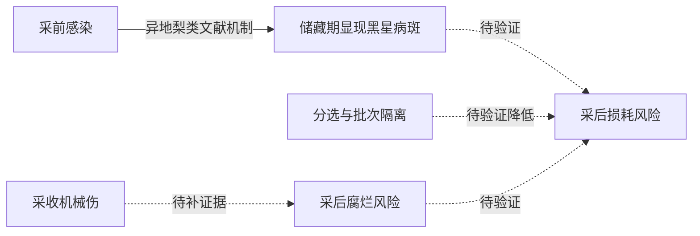

# 知识图谱入口

**当前网页使用 V2。请先阅读 [V2 说明与导入步骤](README-V2.md)。**
以下内容保留为 V1 历史记录，不要使用旧版导出命令覆盖 V2 的导入文件。

## 泊头鸭梨生产—采后知识图谱 V1（历史）

这是可校验、可查询、可导入 Neo4j 的小型种子知识图谱，尚不是经过本地农技专家审定的生产知识库。先跑通知识结构，再扩充可靠资料，不为凑 100～300 个节点制造知识。其他三类农产品留待后续扩展。

## 快速运行

在 `agric/ai-service` 中执行（Windows 使用 `py -3`；其他系统可使用 `python3`）：

```powershell
py -3 knowledge_graph/kg.py validate
py -3 knowledge_graph/kg.py export
py -3 knowledge_graph/kg.py query --node disease:scab --mode research
py -3 knowledge_graph/kg.py query --node disease:scab --mode local
py -3 -m unittest discover -s knowledge_graph/tests -v
```

`research` 显示证据、原适用地区及待验证标识；`local` 只返回已核对的本地事实。黑星病当前没有经本地审定的关系，local 查询返回空，这是证据不足的真实结果。查询是单跳邻域工具，不是 GraphRAG 或自然语言问答。

## 文件

| 文件 | 用途 |
|---|---|
| `ontology.json` | 实体类型、关系端点类型、边语义及审核枚举 |
| `data/graph.json` | 唯一编辑入口：实体、关系、来源目录 |
| `kg.py` | 引用/类型/证据/DAG 校验、邻域查询、文件导出 |
| `generated/import.cypher` | 可重复执行的 Neo4j 导入语句 |
| `generated/graph.md` | 全图 Mermaid 可视化 |
| `queries.cypher` | 多跳研究链与证据查询示例 |
| `tests/test_kg.py` | 数据损坏和证据边界回归检查 |

## 本体与语义

实体包括 Crop、Region、Stage、Disease、Organ、Symptom、Condition、State、Risk、Intervention、Metric、Batch、Observation。来源单独存于 `sources`，导入后为 Source 节点，所有节点共用 KGEntity 唯一 ID。

区分通用“梨”和“泊头鸭梨”；归属关系不能把通用研究自动升级为本地事实。Stage 包括生育期与采后阶段，NEXT_STAGE 只是流程顺序。Batch 和 Observation 预留真实批次与视觉输入位置；当前两者是明确的演示数据，CANDIDATE_DISEASE 不是确诊。

| kind | 含义 | 可用于什么 |
|---|---|---|
| fact | 事实或本体定义 | 检索；仍需检查 scope 与证据 |
| workflow | 阶段、检查、分选、监测流程 | 产品组织，不能作为农业因果 |
| mechanism | 文献描述的方向性机制 | 研究解释，仍需本地适用性审核 |
| hypothesis | 待验证机制/干预假设 | 研究展示，不能作为已证实结论 |
| observation | 示例观测关联 | 感知接口建模，不能倒推出确诊 |

每条关系保留 `evidence_ids`、`claim`、`locator`、`scope`、`crop`、`region`、`stage_ids`、`review_status`、`evidence_level`、`conditions`。空 stage_ids 表示资料未标定阶段，不能据此默认所有阶段均适用。confidence 与 effect_size 当前必须为 null；证据质量、视觉置信度和发生概率是不同概念。

证据等级是项目自定义分类，不是官方 A/B/C 分级。`source_checked` 仅表示核对来源，`transfer_pending` 表示异地梨类资料尚待本地迁移审核，`draft` 表示设计或假设。不要仅改审核字段来“认证”一条关系，必须补充来源和专家审核记录后扩展校验规则。

## 因果链设计



黑星病斑与腐烂不是同一个结果，不直接写成“黑星病必然导致腐烂”。湿润组织与库内相对湿度也不是同一个变量。DAG 校验仅针对 mechanism/hypothesis 子图；通过无环检查不代表因果已识别。当前没有 SCM 方程、混杂变量控制、干预数据或风险标定，不能输出“分选减少多少损耗”或称为定量反事实推断。

## Neo4j 导入与查询

目标为支持 `CREATE CONSTRAINT ... IF NOT EXISTS ... REQUIRE` 的 Neo4j 5+。无需 APOC。使用自己已配置好的 Neo4j 和 `cypher-shell`，从 ai-service 目录运行：

```powershell
cypher-shell -a bolt://localhost:7687 -u neo4j -d neo4j -f knowledge_graph/generated/import.cypher
```

让客户端交互提示输入密码，不把密码写进文件。导入使用 MERGE 按 ID 更新，可重复运行，不清空数据库。删除源 JSON 中的元素不会自动删除数据库旧数据；V1 请在独立实验数据库维护，端点变更也需单独迁移。文件不是全量事务导入，中断后可重新执行。未在当前环境启动或连接 Neo4j，真实数据库导入需在实例可用后验证。

Browser 显示全图：

```cypher
MATCH p=(a:KGEntity)-[r]->(b:KGEntity)
WHERE r.id STARTS WITH 'edge:'
RETURN p LIMIT 100;
```

`queries.cypher` 的研究查询会携带每条边审核状态，不能将其中假设隐藏后供生产回答。Source 节点通过关系的 evidence_ids 查询，后续 GraphRAG 可进一步加入 Document/Chunk 及页码、文本偏移、内容哈希。目前 locator 是网页小节，不是完整的文档分块系统。

## 已核对来源与资料缺口

- [农业农村部网站：泊头丰收节报道](https://nmfsj.moa.gov.cn/dfzt/heibei/zxzx_25728/202109/t20210923_6377404.htm)：仅支持泊头鸭梨产业背景。
- [Agriculture Victoria: Pear scab](https://agriculture.vic.gov.au/biosecurity/plant-diseases/fruit-and-nut-diseases/pome-fruits/pear-scab)：支持通用梨黑星病症状和采前感染后储藏显症等机制；适用地区保留 AU-VIC，不搬用其施药日程。
- [DB13/T 1176-2010 官方目录](https://std.samr.gov.cn/db/search/stdDBDetailed?id=91D99E4D4A902E24E05397BE0A0A3A10)：目录显示已废止且有 2018 更新版；未获取标准全文，不据此填温湿度参数。

下一批优先收集泊头鸭梨现行标准全文、本地黑星病调查、采收分级规程、储藏实验和农技专家审核。来源记录原产区、品种、试验条件、年份和定位信息；先审核，再拆成有条件的关系。跨地区资料可以作为补充证据，但必须保留迁移状态。不要硬过滤到只剩本地资料后，再把缺失内容交给模型猜测。

## 五类问题的当前覆盖

1. 这是什么病：提供病害—症状结构；还不能诊断图片。
2. 为什么发生：提供有条件的机制候选，保留异地适用性说明。
3. 如何处理：提供检查/分选的流程与待审干预；没有处方。
4. 对储藏有什么影响：可查采前感染—储藏显症路径及其来源。
5. 干预如何改变风险：保留方向性假设结构；暂无数值预测。

后续顺序：本地资料审核 → 图谱扩充 → 文档分块与实体绑定 → GraphRAG 评测 → 视觉输入映射 → 可辨识的因果模型 → 再决定是否微调。比赛指标需要实测，不能使用推荐文本中的示例准确率作为成绩。
