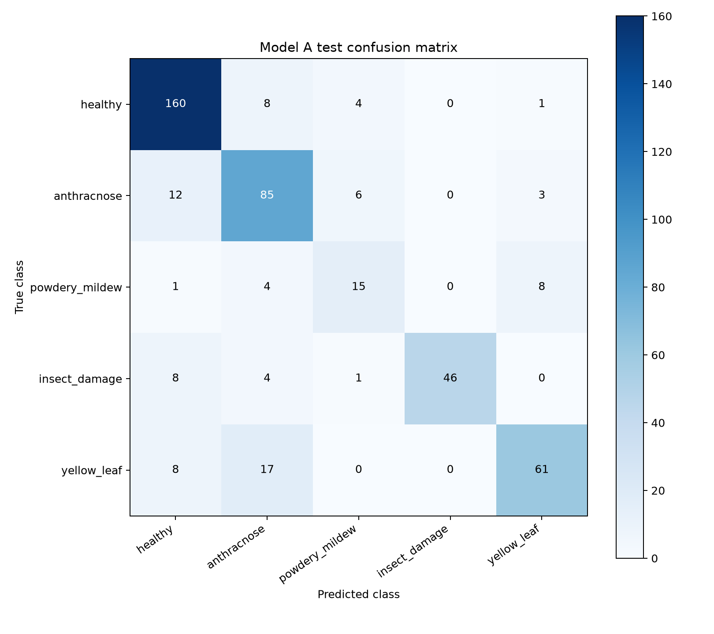
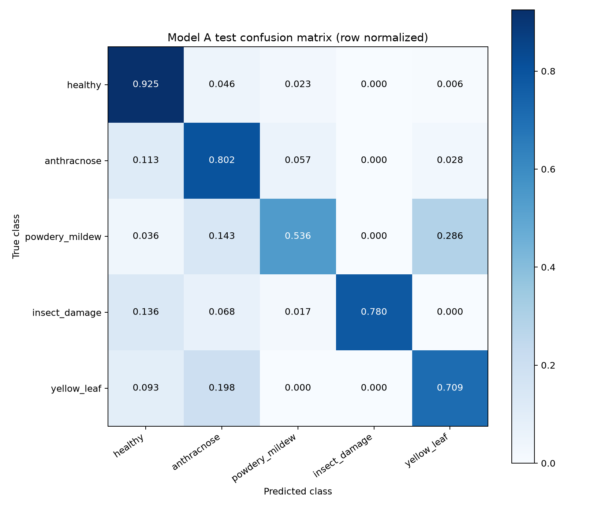

# 金丝小枣视觉 Model A v1 正式评估

模型：YOLO11n-cls；“金丝小枣叶片病害/胁迫视觉分类模型”。输出是视觉症状类别，不是临床/农学确诊。
正式数据：Train 2288 / Val 456 / Test 452。固定 CPU FP32、224×224、crop_fraction=1.0、argmax；未训练、未调整阈值、未根据 Test 选择参数。模型类别索引由 checkpoint names 读取。
训练 early stopping 根据 49 轮、最优 29 轮及 patience=20 推断；未读取服务器终止日志。实际记录如下。
评估读取方式与 8.3.40 官方 ClassificationDataset 一致：cv2.imread → BGR/RGB转换 → 分类 transforms。初次路径列表预测触发 PIL autocast_list，得到 0.7942478；检查源码后纠正读取一致性，而非按 Test 分数选择预处理。正式结果使用官方验证读取流程。
## 全部评估指标与训练记录
```json
{
  "model_path": "F:\\AIC2026\\AIC-SmartAgriculture\\agric\\ai-training\\jujube-vision\\runs\\jujube_leaf_yolo11n_cls_v13\\weights\\best.pt",
  "model_sha256": "57531b0b9e57b5714602cb79717148442ba662309df0e9bb1c3d2e092779c5a2",
  "ultralytics_version": "8.3.40",
  "parameter_count": 1532429,
  "inference": {
    "imgsz": 224,
    "device": "cpu",
    "half": false,
    "augment": false,
    "crop_fraction": 1.0,
    "decision": "argmax",
    "decoder": "cv2.imread matching Ultralytics ClassificationDataset"
  },
  "training": {
    "max_epochs": 80,
    "epochs_completed": 49,
    "best_epoch": 29,
    "best_val_top1": 0.82675,
    "patience": 20,
    "early_stopping_inferred": true,
    "early_stopping_provenance": "inferred from results.csv and args.yaml; no server stop log inspected"
  },
  "overall": {
    "n": 452,
    "accuracy": 0.8119469026548672,
    "macro_precision": 0.7958878689781871,
    "macro_recall": 0.7502839824054287,
    "macro_f1": 0.7683896202422732,
    "balanced_accuracy": 0.7502839824054287,
    "weighted_f1": 0.8110903106226772,
    "present_classes": [
      "healthy",
      "anthracnose",
      "powdery_mildew",
      "insect_damage",
      "yellow_leaf"
    ],
    "missing_classes": [],
    "macro_definition": "unweighted mean over true classes present in this subset; zero division=0",
    "per_class": {
      "healthy": {
        "support": 173,
        "precision": 0.8465608465608465,
        "recall": 0.9248554913294798,
        "f1": 0.8839779005524862
      },
      "anthracnose": {
        "support": 106,
        "precision": 0.7203389830508474,
        "recall": 0.8018867924528302,
        "f1": 0.7589285714285714
      },
      "powdery_mildew": {
        "support": 28,
        "precision": 0.5769230769230769,
        "recall": 0.5357142857142857,
        "f1": 0.5555555555555556
      },
      "insect_damage": {
        "support": 59,
        "precision": 1.0,
        "recall": 0.7796610169491526,
        "f1": 0.8761904761904762
      },
      "yellow_leaf": {
        "support": 86,
        "precision": 0.8356164383561644,
        "recall": 0.7093023255813954,
        "f1": 0.7672955974842768
      }
    }
  },
  "source_wise": {
    "58py9f3nsy": {
      "n": 301,
      "accuracy": 0.7840531561461794,
      "macro_precision": 0.7740137024679724,
      "macro_recall": 0.7122675866339857,
      "macro_f1": 0.7307461585352345,
      "balanced_accuracy": 0.7122675866339856,
      "weighted_f1": 0.782953244057035,
      "present_classes": [
        "healthy",
        "anthracnose",
        "powdery_mildew",
        "insect_damage",
        "yellow_leaf"
      ],
      "missing_classes": [],
      "macro_definition": "unweighted mean over true classes present in this subset; zero division=0",
      "per_class": {
        "healthy": {
          "support": 143,
          "precision": 0.8227848101265823,
          "recall": 0.9090909090909091,
          "f1": 0.8637873754152824
        },
        "anthracnose": {
          "support": 69,
          "precision": 0.6901408450704225,
          "recall": 0.7101449275362319,
          "f1": 0.7
        },
        "powdery_mildew": {
          "support": 17,
          "precision": 0.5,
          "recall": 0.6470588235294118,
          "f1": 0.5641025641025641
        },
        "insect_damage": {
          "support": 31,
          "precision": 1.0,
          "recall": 0.7096774193548387,
          "f1": 0.8301886792452831
        },
        "yellow_leaf": {
          "support": 41,
          "precision": 0.8571428571428571,
          "recall": 0.5853658536585366,
          "f1": 0.6956521739130435
        }
      }
    },
    "yxmf3cd865": {
      "n": 151,
      "accuracy": 0.8675496688741722,
      "macro_precision": 0.9111843209029207,
      "macro_recall": 0.8031948831948832,
      "macro_f1": 0.8238763786304769,
      "balanced_accuracy": 0.8031948831948832,
      "weighted_f1": 0.8604986950226338,
      "present_classes": [
        "healthy",
        "anthracnose",
        "powdery_mildew",
        "insect_damage",
        "yellow_leaf"
      ],
      "missing_classes": [],
      "macro_definition": "unweighted mean over true classes present in this subset; zero division=0",
      "per_class": {
        "healthy": {
          "support": 30,
          "precision": 0.967741935483871,
          "recall": 1.0,
          "f1": 0.9836065573770492
        },
        "anthracnose": {
          "support": 37,
          "precision": 0.7659574468085106,
          "recall": 0.972972972972973,
          "f1": 0.8571428571428571
        },
        "powdery_mildew": {
          "support": 11,
          "precision": 1.0,
          "recall": 0.36363636363636365,
          "f1": 0.5333333333333333
        },
        "insect_damage": {
          "support": 28,
          "precision": 1.0,
          "recall": 0.8571428571428571,
          "f1": 0.9230769230769231
        },
        "yellow_leaf": {
          "support": 45,
          "precision": 0.8222222222222222,
          "recall": 0.8222222222222222,
          "f1": 0.8222222222222222
        }
      }
    }
  },
  "class_order": [
    "healthy",
    "anthracnose",
    "powdery_mildew",
    "insect_damage",
    "yellow_leaf"
  ],
  "confusion_matrix": [
    [
      160,
      8,
      4,
      0,
      1
    ],
    [
      12,
      85,
      6,
      0,
      3
    ],
    [
      1,
      4,
      15,
      0,
      8
    ],
    [
      8,
      4,
      1,
      46,
      0
    ],
    [
      8,
      17,
      0,
      0,
      61
    ]
  ],
  "top_confusion_pairs": [
    {
      "true_class": "yellow_leaf",
      "predicted_class": "anthracnose",
      "count": 17
    },
    {
      "true_class": "anthracnose",
      "predicted_class": "healthy",
      "count": 12
    },
    {
      "true_class": "healthy",
      "predicted_class": "anthracnose",
      "count": 8
    },
    {
      "true_class": "powdery_mildew",
      "predicted_class": "yellow_leaf",
      "count": 8
    },
    {
      "true_class": "insect_damage",
      "predicted_class": "healthy",
      "count": 8
    },
    {
      "true_class": "yellow_leaf",
      "predicted_class": "healthy",
      "count": 8
    },
    {
      "true_class": "anthracnose",
      "predicted_class": "powdery_mildew",
      "count": 6
    },
    {
      "true_class": "healthy",
      "predicted_class": "powdery_mildew",
      "count": 4
    },
    {
      "true_class": "powdery_mildew",
      "predicted_class": "anthracnose",
      "count": 4
    },
    {
      "true_class": "insect_damage",
      "predicted_class": "anthracnose",
      "count": 4
    },
    {
      "true_class": "anthracnose",
      "predicted_class": "yellow_leaf",
      "count": 3
    },
    {
      "true_class": "healthy",
      "predicted_class": "yellow_leaf",
      "count": 1
    },
    {
      "true_class": "powdery_mildew",
      "predicted_class": "healthy",
      "count": 1
    },
    {
      "true_class": "insect_damage",
      "predicted_class": "powdery_mildew",
      "count": 1
    }
  ],
  "high_confidence_errors_ge_08": 25,
  "high_confidence_errors_ge_09": 9,
  "confidence_by_true_class": {
    "healthy": {
      "correct": {
        "n": 160,
        "mean": 0.9248047158122062
      },
      "incorrect": {
        "n": 13,
        "mean": 0.46874468143169695
      }
    },
    "anthracnose": {
      "correct": {
        "n": 85,
        "mean": 0.8010255866190966
      },
      "incorrect": {
        "n": 21,
        "mean": 0.6579738074824923
      }
    },
    "powdery_mildew": {
      "correct": {
        "n": 15,
        "mean": 0.7159220019976298
      },
      "incorrect": {
        "n": 13,
        "mean": 0.6477140555014977
      }
    },
    "insect_damage": {
      "correct": {
        "n": 46,
        "mean": 0.9856005907058716
      },
      "incorrect": {
        "n": 13,
        "mean": 0.7764560328080103
      }
    },
    "yellow_leaf": {
      "correct": {
        "n": 61,
        "mean": 0.8341972461489381
      },
      "incorrect": {
        "n": 25,
        "mean": 0.556029714345932
      }
    }
  },
  "reported_test_top1": 0.812,
  "top1_difference_from_reported": -5.309734513281317e-05,
  "normalization_manifest_available": false,
  "test_files_differing_from_raw_sha": 3,
  "top5": 1.0,
  "top5_note": "All five classes are included in top-5, so this has no discriminatory value",
  "dataset_unchanged": true,
  "weights_unchanged": true
}
```
## 混淆矩阵


## 解释边界
- healthy：健康叶片视觉状态。
- anthracnose：炭疽病类视觉表现。
- powdery_mildew：白粉病类视觉表现。
- insect_damage：虫害损伤视觉表现。
- yellow_leaf：黄化视觉表现，不能直接解释为缺氮、缺铁、盐害或某一种疾病。
confidence 与 prob_* 是模型分类得分，不是疾病确诊概率。后续必须结合环境、生育阶段、管理信息、KG、GraphRAG 研判。
Top-5=1.0 在仅五类的任务中无实际区分意义。来源分层 macro 只平均该来源实际存在的真值类别；缺失类别明确列出，未虚构完整五类支持。置信度分析按真实类别分组，无错误样本时错误均值为 null。
公开数据来源不保证沧州金丝小枣本地适用性；两个来源可能共享机构与拍摄条件。14614 对未确认近重复候选仍属于数据局限。
原始训练/测试划分未变。final 中 JPEG 规范化是已完成的数据处理，不属于此次 Test 调参。高置信度错误及逐图五类得分分别见对应 CSV。

本地缺少上一轮 model_a_normalized_images.csv，无法凭该清单复核历史规范化来源；本次按 v3 manifest 核对文件/标签/来源，逐图严格解码并检查 JPEG EOI，保存实际输入 SHA256 及与 raw 签名差异。此次结果只对应本次记录的测试字节。
## 指标速览

| 指标 | 数值 |
|---|---:|
| accuracy | 81.1947% |
| macro_precision | 79.5888% |
| macro_recall | 75.0284% |
| macro_f1 | 76.8390% |
| balanced_accuracy | 75.0284% |
| weighted_f1 | 81.1090% |

| 类别 | Support | Precision | Recall | F1 |
|---|---:|---:|---:|---:|
| healthy | 173 | 0.8466 | 0.9249 | 0.8840 |
| anthracnose | 106 | 0.7203 | 0.8019 | 0.7589 |
| powdery_mildew | 28 | 0.5769 | 0.5357 | 0.5556 |
| insect_damage | 59 | 1.0000 | 0.7797 | 0.8762 |
| yellow_leaf | 86 | 0.8356 | 0.7093 | 0.7673 |

| 来源 | n | Accuracy | Macro P | Macro R | Macro F1 | Balanced Accuracy |
|---|---:|---:|---:|---:|---:|---:|
| 58py9f3nsy | 301 | 0.7841 | 0.7740 | 0.7123 | 0.7307 | 0.7123 |
| yxmf3cd865 | 151 | 0.8675 | 0.9112 | 0.8032 | 0.8239 | 0.8032 |

两个来源均覆盖全部五类。白粉病类 Recall=53.57%、F1=0.5556；黄化→炭疽病类误判17张，为最大混淆方向。高置信度错误≥0.8为25张，≥0.9为9张。类别得分不能当作确诊概率。
