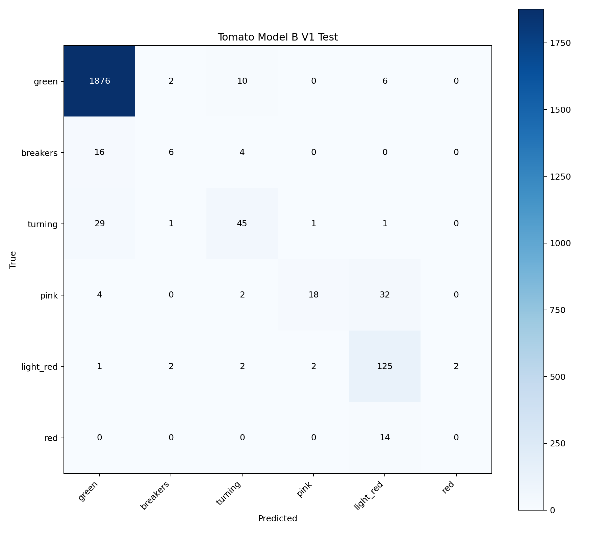
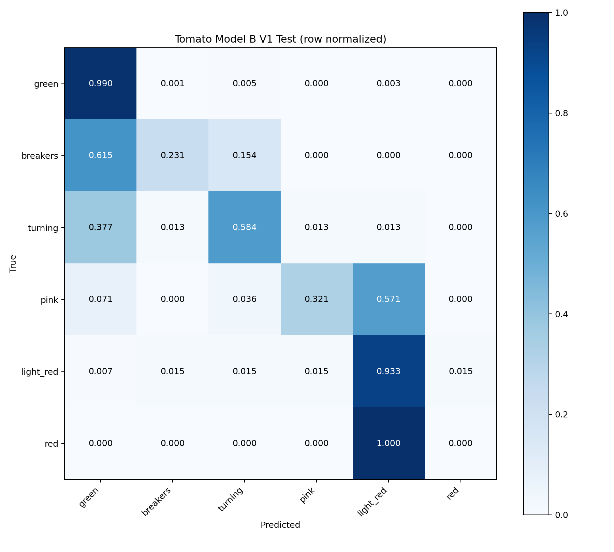

# Tomato Model B V1 正式 Test 评估

AerialYield-T2M：公开温室番茄成熟度图像内部测试集上的视觉分类结果。不是青县现场准确率或真实生产环境泛化准确率。
任务为果实成熟阶段视觉分类，不是品质最终判定或采收决策最终结论。后续需要结合 KG、GraphRAG 和生产环境信息。

本地 best.pt 对全部 2201 张 Test 逐图重新推理；CPU FP32、argmax，尺寸与 crop_fraction 继承训练参数。没有训练、Test 参数搜索、数据修改或冻结。
模型类别索引按 checkpoint 的 names 显式映射至成熟顺序，未假设训练分类索引等于成熟阶段序号。

## 总体指标

- accuracy: 0.9404815992730577
- macro_precision: 0.632194961319187
- macro_recall: 0.5099909186045296
- macro_f1: 0.5363658231459278
- balanced_accuracy: 0.5099909186045296
- weighted_precision: 0.9341725029789456
- weighted_recall: 0.9404815992730577
- weighted_f1: 0.9321993922035312
- macro_roc_auc_ovr: 0.9799802383253765
- stage_mae: 0.09359382099045888
- within_1_stage_accuracy: 0.9750113584734211

## 逐类指标

| Class | Support | Precision | Recall | F1 |
|---|---:|---:|---:|---:|
| green | 1894 | 0.974039 | 0.990496 | 0.982199 |
| breakers | 26 | 0.545455 | 0.230769 | 0.324324 |
| turning | 77 | 0.714286 | 0.584416 | 0.642857 |
| pink | 56 | 0.857143 | 0.321429 | 0.467532 |
| light_red | 134 | 0.702247 | 0.932836 | 0.801282 |
| red | 14 | 0.000000 | 0.000000 | 0.000000 |

重点少数类：breakers、turning、pink、red。训练集严重不平衡，不能仅用 Accuracy 判断成熟阶段分类能力。

## 混淆与序数误差




Top confusion pairs（真实 → 预测）：
- pink → light_red: 32
- turning → green: 29
- breakers → green: 16
- red → light_red: 14
- green → turning: 10
- green → light_red: 6
- breakers → turning: 4
- pink → green: 4
- green → breakers: 2
- pink → turning: 2
- light_red → breakers: 2
- light_red → turning: 2
- light_red → pink: 2
- light_red → red: 2
- turning → breakers: 1
- turning → pink: 1
- turning → light_red: 1
- light_red → green: 1

相邻阶段双向混淆：
- green → breakers: 2; 反向: 16
- breakers → turning: 4; 反向: 1
- turning → pink: 1; 反向: 2
- pink → light_red: 32; 反向: 2
- light_red → red: 2; 反向: 14

阶段距离计数（0 为正确）：{"0": 2070, "1": 76, "2": 42, "3": 6, "4": 7, "5": 0}
阶段间距按 0–5 等距编码，仅为视觉类别的序数误差，不代表生理成熟时间差。

## 高置信错误

>=0.8: 34; >=0.9: 13。CSV 保存所有 >=0.8 的错误。

## 训练记录

```json
{
  "configured_epochs": 80,
  "actual_epochs": 43,
  "best_epoch": 23,
  "best_val_top1": 0.89607,
  "final_val_top1": 0.88418,
  "early_stopping": true,
  "patience": 20,
  "best_val_tied_epochs": [
    23
  ],
  "best_epoch_definition": "First maximum recorded Val Top-1; rounded CSV can contain ties.",
  "early_stopping_evidence": "Inferred from contiguous results.csv ending before configured epochs and at least patience epochs since last maximum Val Top-1; termination event log unavailable."
}
```
early_stopping 为 CSV/配置支持的推断；没有独立终止事件日志。best epoch 是 CSV 首次最高 Val Top-1，不据 Test 选择。

## 数据边界与完整性

```json
{
  "training_ready_image_level": true,
  "session_independent": false,
  "fruit_independent": false,
  "local_qingxian_validated": false,
  "residual_uncertain_near_duplicate_risk": true,
  "confirmed_leak_remaining": 0,
  "uncertain_pair_count": 4
}
```
已处理 pair_017，已复核确认泄漏剩余为0，但仍有4对 uncertain 候选，不能证明 fruit-independent test。
评估前后整个 V2 文件数量、SHA256、大小、mtime 以及模型 SHA256 相同。Test 逐文件哈希见 tomato_model_b_test_integrity.csv。

## 冻结建议与结果解读

不建议冻结为可部署的六阶段成熟度正式模型；可保留为研究基线。 Accuracy=0.9405，Macro-F1=0.5364，Balanced Accuracy=0.5100；类别不平衡使总体指标不能代表少数类能力。 本次零召回类别：red。 高 ROC-AUC 衡量排序能力，不代表当前 argmax 决策下所有类别均能识别。阶段 MAE 和 within-1-stage 也按图片加权，需结合逐类指标解读。未据 Test 修改模型或参数，未执行冻结。

## 完整配置与结果

```json
{
  "accuracy": 0.9404815992730577,
  "macro_precision": 0.632194961319187,
  "macro_recall": 0.5099909186045296,
  "macro_f1": 0.5363658231459278,
  "balanced_accuracy": 0.5099909186045296,
  "weighted_precision": 0.9341725029789456,
  "weighted_recall": 0.9404815992730577,
  "weighted_f1": 0.9321993922035312,
  "macro_roc_auc_ovr": 0.9799802383253765,
  "stage_mae": 0.09359382099045888,
  "within_1_stage_accuracy": 0.9750113584734211,
  "configured_epochs": 80,
  "actual_epochs": 43,
  "best_epoch": 23,
  "best_val_top1": 0.89607,
  "final_val_top1": 0.88418,
  "early_stopping": true,
  "patience": 20,
  "best_val_tied_epochs": [
    23
  ],
  "best_epoch_definition": "First maximum recorded Val Top-1; rounded CSV can contain ties.",
  "early_stopping_evidence": "Inferred from contiguous results.csv ending before configured epochs and at least patience epochs since last maximum Val Top-1; termination event log unavailable.",
  "training_ready_image_level": true,
  "session_independent": false,
  "fruit_independent": false,
  "local_qingxian_validated": false,
  "residual_uncertain_near_duplicate_risk": true,
  "confirmed_leak_remaining": 0,
  "uncertain_pair_count": 4,
  "model_path": "/root/autodl-tmp/AIC-SmartAgriculture/vegetable-vision/runs/tomato_ripeness_yolo11n_cls_v1/weights/best.pt",
  "model_sha256": "09d0c0d8d75e9c1c25a8ba59e015594000cc1169dc234bf1098cbf02f78b8b75",
  "source_dataset": "AerialYield-T2M",
  "evaluation_level": "public greenhouse tomato ripeness internal image test",
  "test_images": 2201,
  "split_counts": {
    "train": {
      "green": 7949,
      "breakers": 119,
      "turning": 432,
      "pink": 322,
      "light_red": 1120,
      "red": 105
    },
    "val": {
      "green": 1466,
      "breakers": 51,
      "turning": 153,
      "pink": 57,
      "light_red": 188,
      "red": 21
    },
    "test": {
      "green": 1894,
      "breakers": 26,
      "turning": 77,
      "pink": 56,
      "light_red": 134,
      "red": 14
    }
  },
  "classes": [
    "green",
    "breakers",
    "turning",
    "pink",
    "light_red",
    "red"
  ],
  "model_class_mapping": {
    "0": "breakers",
    "1": "green",
    "2": "light_red",
    "3": "pink",
    "4": "red",
    "5": "turning"
  },
  "per_class_metrics": {
    "green": {
      "support": 1894,
      "precision": 0.9740394600207685,
      "recall": 0.9904963041182682,
      "f1": 0.9821989528795811
    },
    "breakers": {
      "support": 26,
      "precision": 0.5454545454545454,
      "recall": 0.23076923076923078,
      "f1": 0.32432432432432434
    },
    "turning": {
      "support": 77,
      "precision": 0.7142857142857143,
      "recall": 0.5844155844155844,
      "f1": 0.6428571428571429
    },
    "pink": {
      "support": 56,
      "precision": 0.8571428571428571,
      "recall": 0.32142857142857145,
      "f1": 0.4675324675324675
    },
    "light_red": {
      "support": 134,
      "precision": 0.702247191011236,
      "recall": 0.9328358208955224,
      "f1": 0.8012820512820513
    },
    "red": {
      "support": 14,
      "precision": 0.0,
      "recall": 0.0,
      "f1": 0.0
    }
  },
  "minority_class_metrics": {
    "breakers": {
      "support": 26,
      "precision": 0.5454545454545454,
      "recall": 0.23076923076923078,
      "f1": 0.32432432432432434
    },
    "turning": {
      "support": 77,
      "precision": 0.7142857142857143,
      "recall": 0.5844155844155844,
      "f1": 0.6428571428571429
    },
    "pink": {
      "support": 56,
      "precision": 0.8571428571428571,
      "recall": 0.32142857142857145,
      "f1": 0.4675324675324675
    },
    "red": {
      "support": 14,
      "precision": 0.0,
      "recall": 0.0,
      "f1": 0.0
    }
  },
  "confusion_matrix": [
    [
      1876,
      2,
      10,
      0,
      6,
      0
    ],
    [
      16,
      6,
      4,
      0,
      0,
      0
    ],
    [
      29,
      1,
      45,
      1,
      1,
      0
    ],
    [
      4,
      0,
      2,
      18,
      32,
      0
    ],
    [
      1,
      2,
      2,
      2,
      125,
      2
    ],
    [
      0,
      0,
      0,
      0,
      14,
      0
    ]
  ],
  "confusion_pairs": [
    {
      "true_class": "pink",
      "predicted_class": "light_red",
      "count": 32
    },
    {
      "true_class": "turning",
      "predicted_class": "green",
      "count": 29
    },
    {
      "true_class": "breakers",
      "predicted_class": "green",
      "count": 16
    },
    {
      "true_class": "red",
      "predicted_class": "light_red",
      "count": 14
    },
    {
      "true_class": "green",
      "predicted_class": "turning",
      "count": 10
    },
    {
      "true_class": "green",
      "predicted_class": "light_red",
      "count": 6
    },
    {
      "true_class": "breakers",
      "predicted_class": "turning",
      "count": 4
    },
    {
      "true_class": "pink",
      "predicted_class": "green",
      "count": 4
    },
    {
      "true_class": "green",
      "predicted_class": "breakers",
      "count": 2
    },
    {
      "true_class": "pink",
      "predicted_class": "turning",
      "count": 2
    },
    {
      "true_class": "light_red",
      "predicted_class": "breakers",
      "count": 2
    },
    {
      "true_class": "light_red",
      "predicted_class": "turning",
      "count": 2
    },
    {
      "true_class": "light_red",
      "predicted_class": "pink",
      "count": 2
    },
    {
      "true_class": "light_red",
      "predicted_class": "red",
      "count": 2
    },
    {
      "true_class": "turning",
      "predicted_class": "breakers",
      "count": 1
    },
    {
      "true_class": "turning",
      "predicted_class": "pink",
      "count": 1
    },
    {
      "true_class": "turning",
      "predicted_class": "light_red",
      "count": 1
    },
    {
      "true_class": "light_red",
      "predicted_class": "green",
      "count": 1
    }
  ],
  "adjacent_confusions": [
    {
      "class_a": "green",
      "class_b": "breakers",
      "a_to_b": 2,
      "b_to_a": 16
    },
    {
      "class_a": "breakers",
      "class_b": "turning",
      "a_to_b": 4,
      "b_to_a": 1
    },
    {
      "class_a": "turning",
      "class_b": "pink",
      "a_to_b": 1,
      "b_to_a": 2
    },
    {
      "class_a": "pink",
      "class_b": "light_red",
      "a_to_b": 32,
      "b_to_a": 2
    },
    {
      "class_a": "light_red",
      "class_b": "red",
      "a_to_b": 2,
      "b_to_a": 14
    }
  ],
  "stage_distance_counts": {
    "0": 2070,
    "1": 76,
    "2": 42,
    "3": 6,
    "4": 7,
    "5": 0
  },
  "high_confidence_error_count_08": 34,
  "high_confidence_error_count_09": 13,
  "training_args": {
    "task": "classify",
    "mode": "train",
    "model": "yolo11n-cls.pt",
    "data": "data/tomato_ripeness_classifier_v2",
    "epochs": 80,
    "time": null,
    "patience": 20,
    "batch": 32,
    "imgsz": 224,
    "save": true,
    "save_period": -1,
    "cache": false,
    "device": 0,
    "workers": 8,
    "project": "runs",
    "name": "tomato_ripeness_yolo11n_cls_v1",
    "exist_ok": false,
    "pretrained": true,
    "optimizer": "AdamW",
    "verbose": true,
    "seed": 42,
    "deterministic": true,
    "single_cls": false,
    "rect": false,
    "cos_lr": false,
    "close_mosaic": 10,
    "resume": false,
    "amp": true,
    "fraction": 1.0,
    "profile": false,
    "freeze": null,
    "multi_scale": false,
    "overlap_mask": true,
    "mask_ratio": 4,
    "dropout": 0.0,
    "val": true,
    "split": "val",
    "save_json": false,
    "save_hybrid": false,
    "conf": null,
    "iou": 0.7,
    "max_det": 300,
    "half": false,
    "dnn": false,
    "plots": true,
    "source": null,
    "vid_stride": 1,
    "stream_buffer": false,
    "visualize": false,
    "augment": false,
    "agnostic_nms": false,
    "classes": null,
    "retina_masks": false,
    "embed": null,
    "show": false,
    "save_frames": false,
    "save_txt": false,
    "save_conf": false,
    "save_crop": false,
    "show_labels": true,
    "show_conf": true,
    "show_boxes": true,
    "line_width": null,
    "format": "torchscript",
    "keras": false,
    "optimize": false,
    "int8": false,
    "dynamic": false,
    "simplify": true,
    "opset": null,
    "workspace": null,
    "nms": false,
    "lr0": 0.001,
    "lrf": 0.01,
    "momentum": 0.937,
    "weight_decay": 0.0005,
    "warmup_epochs": 3.0,
    "warmup_momentum": 0.8,
    "warmup_bias_lr": 0.1,
    "box": 7.5,
    "cls": 0.5,
    "dfl": 1.5,
    "pose": 12.0,
    "kobj": 1.0,
    "nbs": 64,
    "hsv_h": 0.015,
    "hsv_s": 0.7,
    "hsv_v": 0.4,
    "degrees": 0.0,
    "translate": 0.1,
    "scale": 0.5,
    "shear": 0.0,
    "perspective": 0.0,
    "flipud": 0.0,
    "fliplr": 0.5,
    "bgr": 0.0,
    "mosaic": 1.0,
    "mixup": 0.0,
    "copy_paste": 0.0,
    "copy_paste_mode": "flip",
    "auto_augment": "randaugment",
    "erasing": 0.4,
    "crop_fraction": 1.0,
    "cfg": null,
    "tracker": "botsort.yaml",
    "save_dir": "runs/tomato_ripeness_yolo11n_cls_v1"
  },
  "inference": {
    "imgsz": 224,
    "crop_fraction": 1.0,
    "device": "cpu",
    "half": false,
    "augment": false,
    "save": false,
    "verbose": false
  },
  "ultralytics_version": "8.3.40",
  "torch_version": "2.8.0+cu128",
  "integrity": {
    "model_sha256_before": "09d0c0d8d75e9c1c25a8ba59e015594000cc1169dc234bf1098cbf02f78b8b75",
    "model_sha256_after": "09d0c0d8d75e9c1c25a8ba59e015594000cc1169dc234bf1098cbf02f78b8b75",
    "model_unchanged": true,
    "dataset_unchanged": true,
    "test_count_before": 2201,
    "test_count_after": 2201
  },
  "freeze_recommendation": "不建议冻结为可部署的六阶段成熟度正式模型；可保留为研究基线。 Accuracy=0.9405，Macro-F1=0.5364，Balanced Accuracy=0.5100；类别不平衡使总体指标不能代表少数类能力。 本次零召回类别：red。 高 ROC-AUC 衡量排序能力，不代表当前 argmax 决策下所有类别均能识别。阶段 MAE 和 within-1-stage 也按图片加权，需结合逐类指标解读。未据 Test 修改模型或参数，未执行冻结。"
}
```
