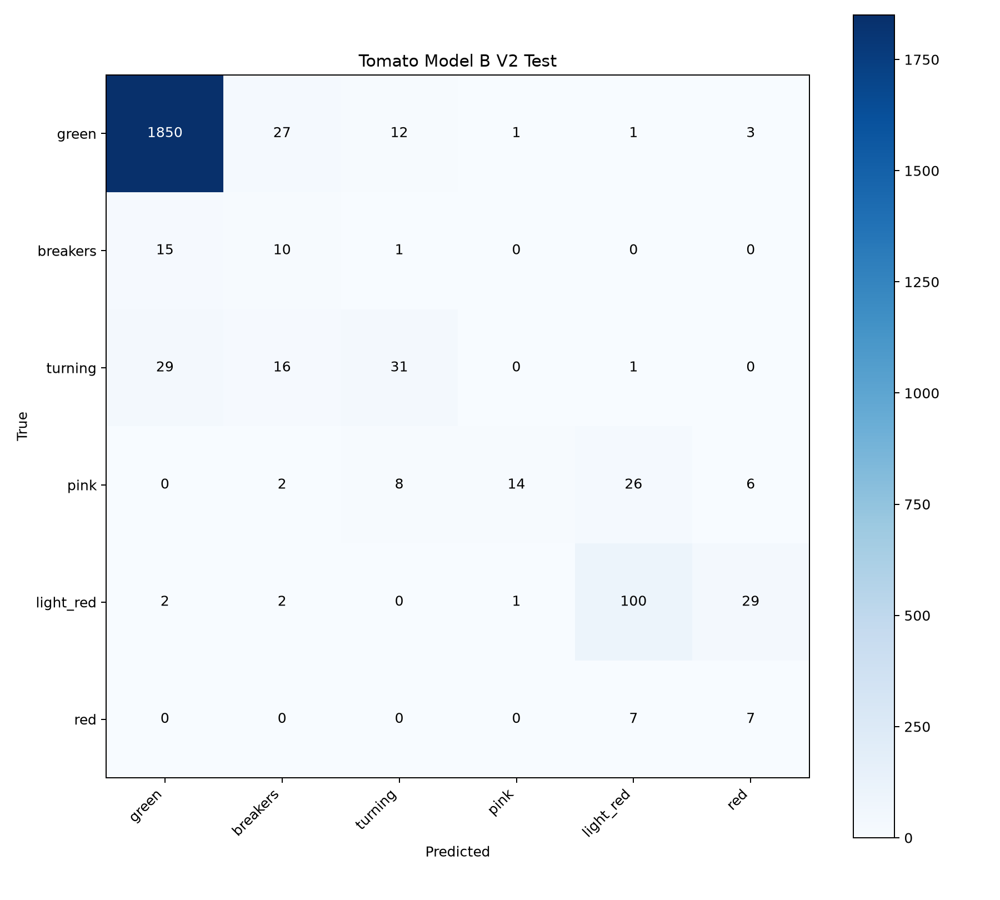
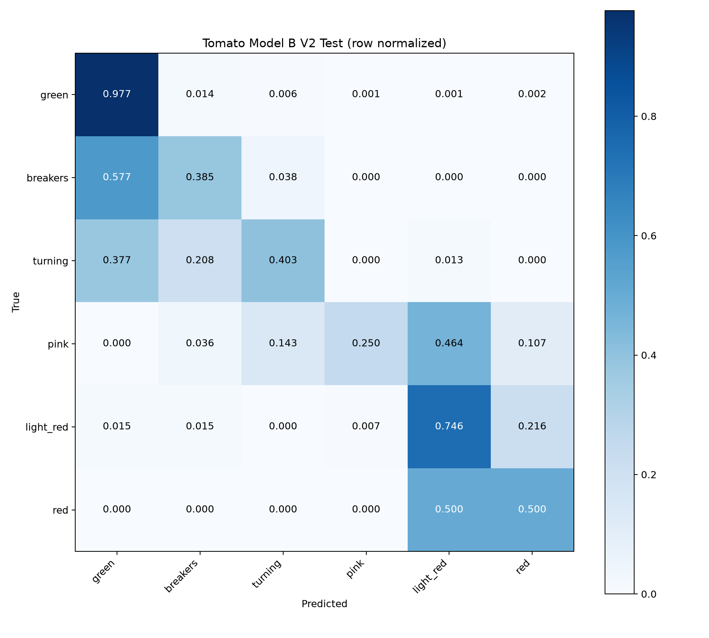

# Tomato Model B V2 Evaluation

AerialYield-T2M：公开温室番茄成熟度图像内部测试集上的视觉分类结果。不是青县现场准确率或真实生产环境泛化准确率。
任务为果实成熟阶段视觉分类，不是品质最终判定或采收决策最终结论。后续需要结合 KG、GraphRAG 和生产环境信息。

本地 best.pt 对全部 2201 张 Test 逐图重新推理；CPU FP32、argmax，尺寸与 crop_fraction 继承训练参数。没有训练、Test 参数搜索、数据修改或冻结。
模型类别索引按 checkpoint 的 names 显式映射至成熟顺序，未假设训练分类索引等于成熟阶段序号。

## 总体指标

- accuracy: 0.9141299409359382
- macro_precision: 0.5864378559276405
- macro_recall: 0.5433750312215694
- macro_f1: 0.5112514594812352
- balanced_accuracy: 0.5433750312215694
- weighted_precision: 0.9309181326244463
- weighted_recall: 0.9141299409359382
- weighted_f1: 0.9164128229645534
- macro_roc_auc_ovr: 0.9729022571208575
- stage_mae: 0.12085415720127216
- within_1_stage_accuracy: 0.9731940027260336

## 逐类指标

| Class | Support | Precision | Recall | F1 |
|---|---:|---:|---:|---:|
| green | 1894 | 0.975738 | 0.976769 | 0.976253 |
| breakers | 26 | 0.175439 | 0.384615 | 0.240964 |
| turning | 77 | 0.596154 | 0.402597 | 0.480620 |
| pink | 56 | 0.875000 | 0.250000 | 0.388889 |
| light_red | 134 | 0.740741 | 0.746269 | 0.743494 |
| red | 14 | 0.155556 | 0.500000 | 0.237288 |

重点少数类：breakers、turning、pink、red。训练集严重不平衡，不能仅用 Accuracy 判断成熟阶段分类能力。

## 混淆与序数误差




Top confusion pairs（真实 → 预测）：
- turning → green: 29
- light_red → red: 29
- green → breakers: 27
- pink → light_red: 26
- turning → breakers: 16
- breakers → green: 15
- green → turning: 12
- pink → turning: 8
- red → light_red: 7
- pink → red: 6
- green → red: 3
- pink → breakers: 2
- light_red → green: 2
- light_red → breakers: 2
- green → pink: 1
- green → light_red: 1
- breakers → turning: 1
- turning → light_red: 1
- light_red → pink: 1

相邻阶段双向混淆：
- green → breakers: 27; 反向: 15
- green → turning: 12; 反向: 29
- breakers → turning: 1; 反向: 16
- turning → pink: 0; 反向: 8
- pink → light_red: 26; 反向: 1
- light_red → red: 29; 反向: 7

阶段距离计数（0 为正确）：{"0": 2012, "1": 130, "2": 50, "3": 3, "4": 3, "5": 3}
阶段间距按 0–5 等距编码，仅为视觉类别的序数误差，不代表生理成熟时间差。

## 高置信错误

>=0.8: 32; >=0.9: 11。CSV 保存所有 >=0.8 的错误。

## 训练记录

```json
{
  "configured_epochs": 80,
  "actual_epochs": 28,
  "best_epoch": 8,
  "best_val_metric": 0.56604,
  "final_val_metric": 0.51738,
  "selection_metric": "Val Macro-F1",
  "early_stopping": true,
  "patience": 20,
  "best_val_tied_epochs": [
    8
  ],
  "best_epoch_definition": "Last maximum recorded Val Macro-F1; rounded CSV ties cannot prove checkpoint epoch.",
  "early_stopping_evidence": "Inferred from contiguous results.csv ending before configured epochs and at least patience epochs since last maximum Val Macro-F1; termination event log unavailable."
}
```
early_stopping 为 CSV/配置支持的推断；没有独立终止事件日志。best epoch 是 CSV 最后最高 Val Macro-F1，不据 Test 选择。

## 数据边界与完整性

```json
{
  "training_ready_image_level": true,
  "session_independent": false,
  "fruit_independent": false,
  "local_qingxian_validated": false,
  "residual_uncertain_near_duplicate_risk": true,
  "confirmed_leak_remaining": 0,
  "uncertain_pair_count": 4
}
```
已处理 pair_017，已复核确认泄漏剩余为0，但仍有4对 uncertain 候选，不能证明 fruit-independent test。
评估前后 Test 文件数量、SHA256、大小、mtime 以及模型 SHA256 相同。Test 逐文件哈希见 tomato_model_b_v2_test_integrity.csv。

## 冻结建议与结果解读

冻结前应结合各类召回率及独立现场验证评估部署适用性。 Accuracy=0.9141，Macro-F1=0.5113，Balanced Accuracy=0.5434；类别不平衡使总体指标不能代表少数类能力。 高 ROC-AUC 衡量排序能力，不代表当前 argmax 决策下所有类别均能识别。阶段 MAE 和 within-1-stage 也按图片加权，需结合逐类指标解读。未据 Test 修改模型或参数，未执行冻结。

## 完整配置与结果

```json
{
  "accuracy": 0.9141299409359382,
  "macro_precision": 0.5864378559276405,
  "macro_recall": 0.5433750312215694,
  "macro_f1": 0.5112514594812352,
  "balanced_accuracy": 0.5433750312215694,
  "weighted_precision": 0.9309181326244463,
  "weighted_recall": 0.9141299409359382,
  "weighted_f1": 0.9164128229645534,
  "macro_roc_auc_ovr": 0.9729022571208575,
  "stage_mae": 0.12085415720127216,
  "within_1_stage_accuracy": 0.9731940027260336,
  "configured_epochs": 80,
  "actual_epochs": 28,
  "best_epoch": 8,
  "best_val_metric": 0.56604,
  "final_val_metric": 0.51738,
  "selection_metric": "Val Macro-F1",
  "early_stopping": true,
  "patience": 20,
  "best_val_tied_epochs": [
    8
  ],
  "best_epoch_definition": "Last maximum recorded Val Macro-F1; rounded CSV ties cannot prove checkpoint epoch.",
  "early_stopping_evidence": "Inferred from contiguous results.csv ending before configured epochs and at least patience epochs since last maximum Val Macro-F1; termination event log unavailable.",
  "training_ready_image_level": true,
  "session_independent": false,
  "fruit_independent": false,
  "local_qingxian_validated": false,
  "residual_uncertain_near_duplicate_risk": true,
  "confirmed_leak_remaining": 0,
  "uncertain_pair_count": 4,
  "model_path": "F:\\AIC2026\\AIC-SmartAgriculture\\agric\\ai-training\\vegetable-vision\\runs\\tomato_ripeness_yolo11n_cls_v2\\weights\\best.pt",
  "model_sha256": "1cec274d19fdf27a065ae95624aacaaba9596395569635e45bb6c8f64d4bab8e",
  "source_dataset": "AerialYield-T2M",
  "evaluation_level": "image_level",
  "test_images": 2201,
  "split_counts": {
    "test": {
      "green": 1894,
      "breakers": 26,
      "turning": 77,
      "pink": 56,
      "light_red": 134,
      "red": 14
    }
  },
  "classes": [
    "green",
    "breakers",
    "turning",
    "pink",
    "light_red",
    "red"
  ],
  "model_class_mapping": {
    "0": "breakers",
    "1": "green",
    "2": "light_red",
    "3": "pink",
    "4": "red",
    "5": "turning"
  },
  "per_class_metrics": {
    "green": {
      "support": 1894,
      "precision": 0.9757383966244726,
      "recall": 0.9767687434002112,
      "f1": 0.9762532981530343
    },
    "breakers": {
      "support": 26,
      "precision": 0.17543859649122806,
      "recall": 0.38461538461538464,
      "f1": 0.24096385542168675
    },
    "turning": {
      "support": 77,
      "precision": 0.5961538461538461,
      "recall": 0.4025974025974026,
      "f1": 0.4806201550387597
    },
    "pink": {
      "support": 56,
      "precision": 0.875,
      "recall": 0.25,
      "f1": 0.3888888888888889
    },
    "light_red": {
      "support": 134,
      "precision": 0.7407407407407407,
      "recall": 0.746268656716418,
      "f1": 0.7434944237918215
    },
    "red": {
      "support": 14,
      "precision": 0.15555555555555556,
      "recall": 0.5,
      "f1": 0.23728813559322035
    }
  },
  "minority_class_metrics": {
    "breakers": {
      "support": 26,
      "precision": 0.17543859649122806,
      "recall": 0.38461538461538464,
      "f1": 0.24096385542168675
    },
    "turning": {
      "support": 77,
      "precision": 0.5961538461538461,
      "recall": 0.4025974025974026,
      "f1": 0.4806201550387597
    },
    "pink": {
      "support": 56,
      "precision": 0.875,
      "recall": 0.25,
      "f1": 0.3888888888888889
    },
    "red": {
      "support": 14,
      "precision": 0.15555555555555556,
      "recall": 0.5,
      "f1": 0.23728813559322035
    }
  },
  "confusion_matrix": [
    [
      1850,
      27,
      12,
      1,
      1,
      3
    ],
    [
      15,
      10,
      1,
      0,
      0,
      0
    ],
    [
      29,
      16,
      31,
      0,
      1,
      0
    ],
    [
      0,
      2,
      8,
      14,
      26,
      6
    ],
    [
      2,
      2,
      0,
      1,
      100,
      29
    ],
    [
      0,
      0,
      0,
      0,
      7,
      7
    ]
  ],
  "confusion_pairs": [
    {
      "true_class": "turning",
      "predicted_class": "green",
      "count": 29
    },
    {
      "true_class": "light_red",
      "predicted_class": "red",
      "count": 29
    },
    {
      "true_class": "green",
      "predicted_class": "breakers",
      "count": 27
    },
    {
      "true_class": "pink",
      "predicted_class": "light_red",
      "count": 26
    },
    {
      "true_class": "turning",
      "predicted_class": "breakers",
      "count": 16
    },
    {
      "true_class": "breakers",
      "predicted_class": "green",
      "count": 15
    },
    {
      "true_class": "green",
      "predicted_class": "turning",
      "count": 12
    },
    {
      "true_class": "pink",
      "predicted_class": "turning",
      "count": 8
    },
    {
      "true_class": "red",
      "predicted_class": "light_red",
      "count": 7
    },
    {
      "true_class": "pink",
      "predicted_class": "red",
      "count": 6
    },
    {
      "true_class": "green",
      "predicted_class": "red",
      "count": 3
    },
    {
      "true_class": "pink",
      "predicted_class": "breakers",
      "count": 2
    },
    {
      "true_class": "light_red",
      "predicted_class": "green",
      "count": 2
    },
    {
      "true_class": "light_red",
      "predicted_class": "breakers",
      "count": 2
    },
    {
      "true_class": "green",
      "predicted_class": "pink",
      "count": 1
    },
    {
      "true_class": "green",
      "predicted_class": "light_red",
      "count": 1
    },
    {
      "true_class": "breakers",
      "predicted_class": "turning",
      "count": 1
    },
    {
      "true_class": "turning",
      "predicted_class": "light_red",
      "count": 1
    },
    {
      "true_class": "light_red",
      "predicted_class": "pink",
      "count": 1
    }
  ],
  "adjacent_confusions": [
    {
      "class_a": "green",
      "class_b": "breakers",
      "a_to_b": 27,
      "b_to_a": 15
    },
    {
      "class_a": "green",
      "class_b": "turning",
      "a_to_b": 12,
      "b_to_a": 29
    },
    {
      "class_a": "breakers",
      "class_b": "turning",
      "a_to_b": 1,
      "b_to_a": 16
    },
    {
      "class_a": "turning",
      "class_b": "pink",
      "a_to_b": 0,
      "b_to_a": 8
    },
    {
      "class_a": "pink",
      "class_b": "light_red",
      "a_to_b": 26,
      "b_to_a": 1
    },
    {
      "class_a": "light_red",
      "class_b": "red",
      "a_to_b": 29,
      "b_to_a": 7
    }
  ],
  "stage_distance_counts": {
    "0": 2012,
    "1": 130,
    "2": 50,
    "3": 3,
    "4": 3,
    "5": 3
  },
  "high_confidence_error_count_08": 32,
  "high_confidence_error_count_09": 11,
  "training_args": {
    "task": "classify",
    "mode": "train",
    "model": "/root/autodl-tmp/AIC-SmartAgriculture/vegetable-vision/yolo11n-cls.pt",
    "data": "/root/autodl-tmp/AIC-SmartAgriculture/vegetable-vision/data/tomato_ripeness_classifier_v2",
    "epochs": 80,
    "time": null,
    "patience": 20,
    "batch": 32,
    "imgsz": 224,
    "save": true,
    "save_period": -1,
    "cache": false,
    "device": "0",
    "workers": 0,
    "project": "/root/autodl-tmp/AIC-SmartAgriculture/vegetable-vision/runs",
    "name": "tomato_ripeness_yolo11n_cls_v2",
    "exist_ok": false,
    "pretrained": true,
    "optimizer": "AdamW",
    "verbose": true,
    "seed": 42,
    "deterministic": true,
    "single_cls": false,
    "rect": false,
    "cos_lr": false,
    "close_mosaic": 10,
    "resume": false,
    "amp": false,
    "fraction": 1.0,
    "profile": false,
    "freeze": null,
    "multi_scale": false,
    "overlap_mask": true,
    "mask_ratio": 4,
    "dropout": 0.0,
    "val": true,
    "split": "val",
    "save_json": false,
    "save_hybrid": false,
    "conf": null,
    "iou": 0.7,
    "max_det": 300,
    "half": false,
    "dnn": false,
    "plots": false,
    "source": null,
    "vid_stride": 1,
    "stream_buffer": false,
    "visualize": false,
    "augment": false,
    "agnostic_nms": false,
    "classes": null,
    "retina_masks": false,
    "embed": null,
    "show": false,
    "save_frames": false,
    "save_txt": false,
    "save_conf": false,
    "save_crop": false,
    "show_labels": true,
    "show_conf": true,
    "show_boxes": true,
    "line_width": null,
    "format": "torchscript",
    "keras": false,
    "optimize": false,
    "int8": false,
    "dynamic": false,
    "simplify": true,
    "opset": null,
    "workspace": null,
    "nms": false,
    "lr0": 0.001,
    "lrf": 0.01,
    "momentum": 0.937,
    "weight_decay": 0.0005,
    "warmup_epochs": 3.0,
    "warmup_momentum": 0.8,
    "warmup_bias_lr": 0.1,
    "box": 7.5,
    "cls": 0.5,
    "dfl": 1.5,
    "pose": 12.0,
    "kobj": 1.0,
    "nbs": 64,
    "hsv_h": 0.015,
    "hsv_s": 0.7,
    "hsv_v": 0.4,
    "degrees": 0.0,
    "translate": 0.1,
    "scale": 0.5,
    "shear": 0.0,
    "perspective": 0.0,
    "flipud": 0.0,
    "fliplr": 0.5,
    "bgr": 0.0,
    "mosaic": 1.0,
    "mixup": 0.0,
    "copy_paste": 0.0,
    "copy_paste_mode": "flip",
    "auto_augment": "randaugment",
    "erasing": 0.4,
    "crop_fraction": 1.0,
    "cfg": null,
    "tracker": "botsort.yaml",
    "save_dir": "/root/autodl-tmp/AIC-SmartAgriculture/vegetable-vision/runs/tomato_ripeness_yolo11n_cls_v2"
  },
  "inference": {
    "imgsz": 224,
    "crop_fraction": 1.0,
    "device": "cpu",
    "half": false,
    "augment": false,
    "save": false,
    "verbose": false
  },
  "ultralytics_version": "8.3.40",
  "torch_version": "2.5.1+cpu",
  "integrity": {
    "model_sha256_before": "1cec274d19fdf27a065ae95624aacaaba9596395569635e45bb6c8f64d4bab8e",
    "model_sha256_after": "1cec274d19fdf27a065ae95624aacaaba9596395569635e45bb6c8f64d4bab8e",
    "model_unchanged": true,
    "dataset_unchanged": true,
    "test_count_before": 2201,
    "test_count_after": 2201
  },
  "freeze_recommendation": "冻结前应结合各类召回率及独立现场验证评估部署适用性。 Accuracy=0.9141，Macro-F1=0.5113，Balanced Accuracy=0.5434；类别不平衡使总体指标不能代表少数类能力。 高 ROC-AUC 衡量排序能力，不代表当前 argmax 决策下所有类别均能识别。阶段 MAE 和 within-1-stage 也按图片加权，需结合逐类指标解读。未据 Test 修改模型或参数，未执行冻结。",
  "sampling_method": "WeightedRandomSampler",
  "sampling_weight": "1/sqrt(class_frequency)",
  "fruit_independent_verified": false,
  "v1_v2_comparison": [
    {
      "metric": "accuracy",
      "v1": 0.9404815992730577,
      "v2": 0.9141299409359382,
      "delta": -0.0263516583371195
    },
    {
      "metric": "macro_f1",
      "v1": 0.5363658231459278,
      "v2": 0.5112514594812352,
      "delta": -0.025114363664692663
    },
    {
      "metric": "balanced_accuracy",
      "v1": 0.5099909186045296,
      "v2": 0.5433750312215694,
      "delta": 0.033384112617039774
    },
    {
      "metric": "green_recall",
      "v1": 0.9904963041182682,
      "v2": 0.9767687434002112,
      "delta": -0.01372756071805692
    },
    {
      "metric": "breakers_recall",
      "v1": 0.23076923076923078,
      "v2": 0.38461538461538464,
      "delta": 0.15384615384615385
    },
    {
      "metric": "turning_recall",
      "v1": 0.5844155844155844,
      "v2": 0.4025974025974026,
      "delta": -0.18181818181818177
    },
    {
      "metric": "pink_recall",
      "v1": 0.32142857142857145,
      "v2": 0.25,
      "delta": -0.07142857142857145
    },
    {
      "metric": "light_red_recall",
      "v1": 0.9328358208955224,
      "v2": 0.746268656716418,
      "delta": -0.18656716417910446
    },
    {
      "metric": "red_recall",
      "v1": 0.0,
      "v2": 0.5,
      "delta": 0.5
    }
  ],
  "actual_config_differences": {
    "amp": {
      "v1": true,
      "v2": false
    },
    "workers": {
      "v1": 8,
      "v2": 0
    },
    "plots": {
      "v1": true,
      "v2": false
    }
  }
}
```

## V1 baseline vs V2 weighted sampling

实验目的：通过 WeightedRandomSampler 缓解六阶段成熟度类别不平衡。主要训练干预为 Train sampling strategy；权重为 1/sqrt(class_frequency)。
保持 YOLO11n-cls、imgsz=224、AdamW、lr0=0.001、seed=42。另有 Val Macro-F1 选模及实际配置差异，不能声称严格只有一个变量改变。
实际配置差异：{"amp": {"v1": true, "v2": false}, "workers": {"v1": 8, "v2": 0}, "plots": {"v1": true, "v2": false}}
Test 已在 V1 阶段被观察，V2 Test 不属于完全未触碰的 blind test；本次没有据 Test 调整任何参数。

| Metric | V1 | V2 | Delta |
|---|---:|---:|---:|
| accuracy | 0.940482 | 0.914130 | -0.026352 |
| macro_f1 | 0.536366 | 0.511251 | -0.025114 |
| balanced_accuracy | 0.509991 | 0.543375 | +0.033384 |
| green_recall | 0.990496 | 0.976769 | -0.013728 |
| breakers_recall | 0.230769 | 0.384615 | +0.153846 |
| turning_recall | 0.584416 | 0.402597 | -0.181818 |
| pink_recall | 0.321429 | 0.250000 | -0.071429 |
| light_red_recall | 0.932836 | 0.746269 | -0.186567 |
| red_recall | 0.000000 | 0.500000 | +0.500000 |

少数类 Recall/F1（V1 → V2）：
- breakers: Recall 0.2308 → 0.3846; F1 0.3243 → 0.2410
- turning: Recall 0.5844 → 0.4026; F1 0.6429 → 0.4806
- pink: Recall 0.3214 → 0.2500; F1 0.4675 → 0.3889
- red: Recall 0.0000 → 0.5000; F1 0.0000 → 0.2373


## 对比结论

red、breakers 的 Recall 提高，但 breakers Precision/F1 下降，turning、pink、light_red 也退化。Accuracy 和 Macro-F1 下降，因此不能称为整体提升，不建议据此宣称正式部署能力。red Test 仅14张，统计波动较大。

目录整理后重新校验模型和全部2201张Test哈希，均与评估时一致；仅更新结果文件路径，没有重复Test推理或调参。
