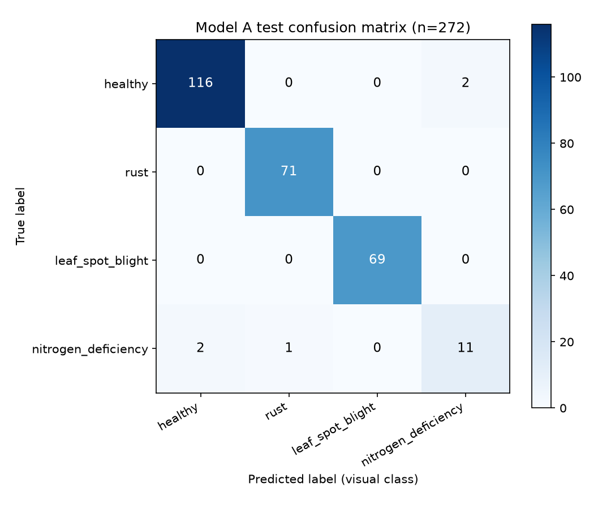

# 黄骅旱碱麦 视觉模型A 测试集评估报告

评估对象：`runs/wheat_leaf_yolo11n_cls_v1/weights/best.pt`；测试集：`data/leaf_classifier/test` 共 272 张；imgsz=224，device=cpu。

> 说明：YOLO 输出的 confidence 是**视觉类别置信度**，不是“病害概率”。`nitrogen_deficiency` 仅表示“**缺氮类视觉表现**”，不等于确诊缺氮。

## 1. Test Accuracy

**0.9816（98.16%）** — 正确 267 / 共 272

## 2. Macro-F1

**0.9477**

## 3. Balanced Accuracy

**0.9422**

## 4. 每类 Precision / Recall / F1 / Support

| 类别 | Precision | Recall | F1-score | Support |
| --- | ---: | ---: | ---: | ---: |
| healthy | 0.9831 | 0.9831 | 0.9831 | 118 |
| rust | 0.9861 | 1.0000 | 0.9930 | 71 |
| leaf_spot_blight | 1.0000 | 1.0000 | 1.0000 | 69 |
| nitrogen_deficiency | 0.8462 | 0.7857 | 0.8148 | 14 |
| **macro avg** | 0.9538 | 0.9422 | 0.9477 | 272 |

## 5. Confusion Matrix

| 真实\预测 | healthy | rust | leaf_spot_blight | nitrogen_deficiency |
| --- | ---: | ---: | ---: | ---: |
| **healthy** | 116 | 0 | 0 | 2 |
| **rust** | 0 | 71 | 0 | 0 |
| **leaf_spot_blight** | 0 | 0 | 69 | 0 |
| **nitrogen_deficiency** | 2 | 1 | 0 | 11 |

## 6. 错误图片数量

- 总正确：**267**；总错误：**5**（错误清单见 `model_a_misclassified.csv`）

## 7. nitrogen_deficiency 14 张中正确张数

- 正确 **11 / 14**，错误 3 张。

## 8. nitrogen_deficiency Recall

- Recall = **0.7857**（缺氮类视觉表现的检出率）

## 9. 最容易混淆的两个类别

- 类别对：**healthy ↔ nitrogen_deficiency**，双向合计 **4** 次（healthy→nitrogen_deficiency 2 次；nitrogen_deficiency→healthy 2 次）。

## 10. 是否建议进入部署阶段

- **可谨慎进入部署（试运行）**：整体与各类指标达到基本可用水平，但 nitrogen_deficiency 样本仅 14 张，须持续监控并明确“视觉类别/缺氮类视觉表现”的表述边界。

- 依据：Balanced Accuracy=0.9422，Macro-F1=0.9477，nitrogen_deficiency Recall=0.7857。

- 风险提示：模型只输出视觉类别；`nitrogen_deficiency` 不可表述为“确诊缺氮”，实际诊断需结合土壤/植株理化检测。
