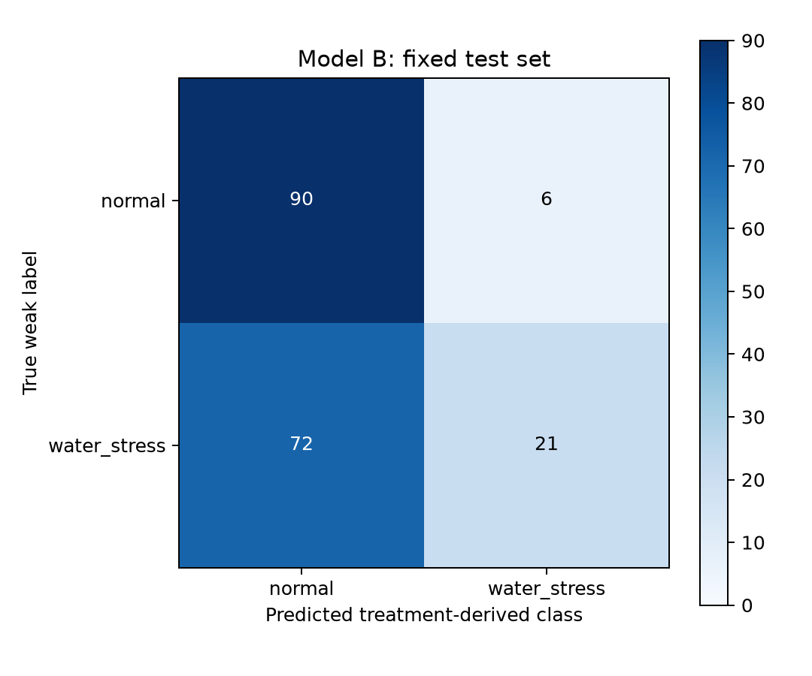

# Model B Evaluation

## 1. Task definition

Model B 是实验处理组 weak supervision 冠层视觉分类器。normal 表示对照处理组；water_stress 是 treatment-derived weak label，表示 post-anthesis deficit-irrigation treatment group，不表示逐图确认实际缺水。模型置信度不是土壤缺水或疾病概率。

## 2. Dataset

| split | sample_count | normal | water_stress | plots |
| --- | --- | --- | --- | --- |
| train | 848 | 426 | 422 | 62 |
| val | 189 | 95 | 94 | 14 |
| test | 189 | 96 | 93 | 14 |

本次重新按真实图像 SHA256 核对弱标签 split manifest：{'cross_split_plot': 0, 'cross_split_sha256': 0}。plot-aware split 将同编号 replicate 跨季保守绑定；同一 plot 的不同日期不是独立样本。原清理审计记录：pre-stress/冲突/损坏进入均为 0，raw 修改为 0；这些历史字段不等于逐图实测胁迫。清单保存的旧绝对路径与当前嵌套目录不同，本次使用目标文件名与完整 SHA256 匹配，未改清单。

## 3. Training result

{
  "best_epoch": 6,
  "best_val_top1": 0.60317,
  "last_recorded_epoch": 21,
  "official_test_top1_user_provided": 0.587
}

results.csv 验证最佳 epoch 和验证精度、记录至 epoch 21；early stop 原因由用户提供，args.yaml patience=15 与 epoch 6 后 15 轮一致。官方 test top1=0.587 是用户提供的参考，非本地日志读取。

## 4. Formal test metrics

| test_samples | accuracy | macro_precision | macro_recall | macro_f1 | balanced_accuracy |
| --- | --- | --- | --- | --- | --- |
| 189 | 0.587302 | 0.666667 | 0.581653 | 0.523837 | 0.581653 |

与参考 0.587 的绝对差：0.000302；1 个百分点一致性检查通过。推理 Ultralytics 8.3.40 / imgsz=224 / workers=0 / FP32 / 无增强。

## 5. Per-class metrics

| class | precision | recall | f1_score | support |
| --- | --- | --- | --- | --- |
| normal | 0.555556 | 0.937500 | 0.697674 | 96 |
| water_stress | 0.777778 | 0.225806 | 0.350000 | 93 |

## 6. Confusion matrix

行是真实处理组弱标签，列是预测类别；顺序 normal, water_stress。无医学 TP/TN 含义。

```json
[[90, 6], [72, 21]]
```



## 7. Season-wise analysis

| season | sample_count | accuracy | macro_precision | macro_recall | macro_f1 | balanced_accuracy |
| --- | --- | --- | --- | --- | --- | --- |
| 1 | 63 | 0.619048 | 0.653061 | 0.606061 | 0.580931 | 0.606061 |
| 2 | 126 | 0.571429 | 0.692988 | 0.571429 | 0.491328 | 0.571429 |

两季 accuracy 差 0.0476；macro-F1 差 0.0896。这是 season-dependent performance 描述，不能证明模型学到了季节背景。两季均出现在训练集，故此处不是留一季泛化实验。

## 8. Date-wise analysis

| season | das | date | sample_count | normal_count | water_stress_count | accuracy | macro_f1 | balanced_accuracy |
| --- | --- | --- | --- | --- | --- | --- | --- | --- |
| 1 | 175 | 2015-05-15 | 14 | 7 | 7 | 0.500000 | 0.333333 | 0.500000 |
| 1 | 189 | 2015-05-29 | 7 | 5 | 2 | 0.571429 | 0.363636 | 0.400000 |
| 1 | 192 | 2015-06-01 | 14 | 7 | 7 | 0.857143 | 0.857143 | 0.857143 |
| 1 | 197 | 2015-06-06 | 14 | 7 | 7 | 0.571429 | 0.533333 | 0.571429 |
| 1 | 205 | 2015-06-14 | 14 | 7 | 7 | 0.571429 | 0.533333 | 0.571429 |
| 2 | 188 | 2016-05-11 | 14 | 7 | 7 | 0.500000 | 0.333333 | 0.500000 |
| 2 | 191 | 2016-05-14 | 14 | 7 | 7 | 0.500000 | 0.333333 | 0.500000 |
| 2 | 194 | 2016-05-17 | 14 | 7 | 7 | 0.428571 | 0.300000 | 0.428571 |
| 2 | 197 | 2016-05-20 | 14 | 7 | 7 | 0.500000 | 0.333333 | 0.500000 |
| 2 | 200 | 2016-05-23 | 14 | 7 | 7 | 0.500000 | 0.333333 | 0.500000 |
| 2 | 208 | 2016-05-31 | 14 | 7 | 7 | 0.642857 | 0.625668 | 0.642857 |
| 2 | 211 | 2016-06-03 | 14 | 7 | 7 | 0.714286 | 0.688889 | 0.714286 |
| 2 | 214 | 2016-06-06 | 14 | 7 | 7 | 0.857143 | 0.854167 | 0.857143 |
| 2 | 228 | 2016-06-20 | 14 | 7 | 7 | 0.500000 | 0.333333 | 0.500000 |

最高/最低日期按 accuracy 选取，平局全部保留于 JSON best_dates/worst_dates。每天仅少量测试 plot，最佳/最差差异不代表实际胁迫强度。

Season 1: first→last accuracy 0.5000→0.5714，macro-F1 0.3333→0.5333；中间日期有波动，无单调增强趋势；不能解释为胁迫强度变化。
Season 2: first→last accuracy 0.5000→0.5000，macro-F1 0.3333→0.3333；中间日期有波动，无单调增强趋势；不能解释为胁迫强度变化。

## 9. Plot-wise analysis

| plot_id | season | sample_count | true_treatment | correct_count | accuracy | mean_confidence |
| --- | --- | --- | --- | --- | --- | --- |
| 10r1 | 1 | 5 | control | 4 | 0.800000 | 0.704716 |
| 10r1 | 2 | 9 | control | 9 | 1.000000 | 0.865987 |
| 12r2 | 1 | 5 | control | 5 | 1.000000 | 0.864214 |
| 12r2 | 2 | 9 | control | 9 | 1.000000 | 0.874089 |
| 13r3 | 1 | 5 | control | 5 | 1.000000 | 0.909739 |
| 13r3 | 2 | 9 | control | 9 | 1.000000 | 0.732159 |
| 17r2 | 1 | 5 | water_stress | 1 | 0.200000 | 0.701697 |
| 17r2 | 2 | 9 | water_stress | 0 | 0.000000 | 0.778238 |
| 22r3 | 1 | 4 | water_stress | 2 | 0.500000 | 0.648803 |
| 22r3 | 2 | 9 | water_stress | 3 | 0.333333 | 0.709739 |
| 23r1 | 1 | 4 | water_stress | 2 | 0.500000 | 0.656522 |
| 23r1 | 2 | 9 | water_stress | 3 | 0.333333 | 0.711054 |
| 24r3 | 1 | 5 | water_stress | 1 | 0.200000 | 0.702199 |
| 24r3 | 2 | 9 | water_stress | 1 | 0.111111 | 0.709597 |
| 25r1 | 1 | 4 | water_stress | 1 | 0.250000 | 0.692173 |
| 25r1 | 2 | 9 | water_stress | 1 | 0.111111 | 0.670570 |
| 27r2 | 1 | 4 | water_stress | 2 | 0.500000 | 0.613604 |
| 27r2 | 2 | 9 | water_stress | 3 | 0.333333 | 0.657895 |
| 28r3 | 1 | 4 | water_stress | 1 | 0.250000 | 0.694889 |
| 28r3 | 2 | 9 | water_stress | 0 | 0.000000 | 0.714695 |
| 2r2 | 1 | 4 | control | 4 | 1.000000 | 0.713847 |
| 2r2 | 2 | 9 | control | 8 | 0.888889 | 0.643826 |
| 7r3 | 1 | 5 | control | 4 | 0.800000 | 0.744271 |
| 7r3 | 2 | 9 | control | 9 | 1.000000 | 0.742268 |
| 8r1 | 1 | 5 | control | 3 | 0.600000 | 0.605386 |
| 8r1 | 2 | 9 | control | 9 | 1.000000 | 0.822748 |
| 9r3 | 1 | 4 | control | 4 | 1.000000 | 0.762197 |
| 9r3 | 2 | 9 | control | 8 | 0.888889 | 0.675370 |

按季列出 plot；跨季同编号已在 split 中绑定。accuracy≤0.2 仅作为几乎全部误判的描述阈值。对应组：[{"plot_id": "17r2", "season": "1", "accuracy": 0.2}, {"plot_id": "17r2", "season": "2", "accuracy": 0.0}, {"plot_id": "24r3", "season": "1", "accuracy": 0.2}, {"plot_id": "24r3", "season": "2", "accuracy": 0.1111111111111111}, {"plot_id": "25r1", "season": "2", "accuracy": 0.1111111111111111}, {"plot_id": "28r3", "season": "2", "accuracy": 0.0}]

## 10. Misclassification analysis

错误 78 张，confidence≥0.8 的错误 11 张。详见 model_b_misclassified.csv，按置信度降序排列。错误针对处理组标签，不等价实际胁迫漏诊/误诊。

## 11. Confidence analysis

| group | sample_count | mean_confidence | median_confidence | min | max |
| --- | --- | --- | --- | --- | --- |
| all | 189 | 0.730494 | 0.710680 | 0.504958 | 0.997433 |
| correct | 111 | 0.759487 | 0.748998 | 0.504958 | 0.997433 |
| wrong | 78 | 0.689234 | 0.692198 | 0.510168 | 0.968610 |
| predicted_normal | 162 | 0.740996 | 0.728898 | 0.504958 | 0.997433 |
| predicted_water_stress | 27 | 0.667479 | 0.668628 | 0.512782 | 0.938192 |

置信度仅为类别模型输出；高置信度错误不能证明或否定实际水分状态。

## 12. Weak-supervision limitations

1. exact deficit-irrigation start date is unknown。
2. water_stress is a treatment-derived weak label，未逐图实测胁迫。
3. test accuracy should not be interpreted as clinical/physical diagnosis accuracy。
4. visual output should be treated as one piece of evidence for downstream multimodal risk reasoning。
5. 本数据来自原实验地点而非黄骅实地；尚未验证黄骅部署泛化。
6. 日期/季节表现差异不能确认弱标签噪声、视觉捷径或模型容量不足的因果作用。

## 13. Conclusion

该 baseline 整体 accuracy=58.73%、macro-F1=0.5238，仅有有限处理组可分性，尚不支持实际缺水诊断。最直接的实测问题是预测偏向 normal：162/189 张预测为 normal，water_stress 处理组 recall 仅 22.58%。日期 accuracy 范围 42.86%–85.71%。存在 date dependence，且没有后期日期单调改善的趋势；两季也存在一定表现差异。弱标签噪声与模型容量无法单凭这些评估确认。本阶段到此结束，不训练或修改数据。
