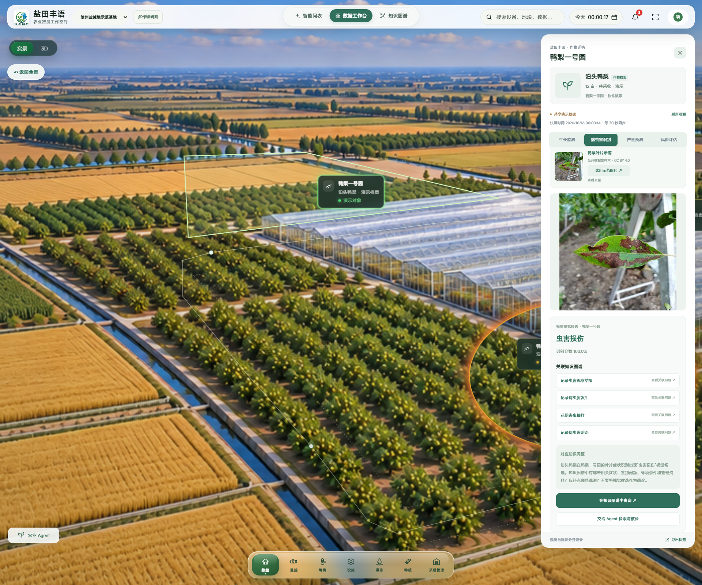
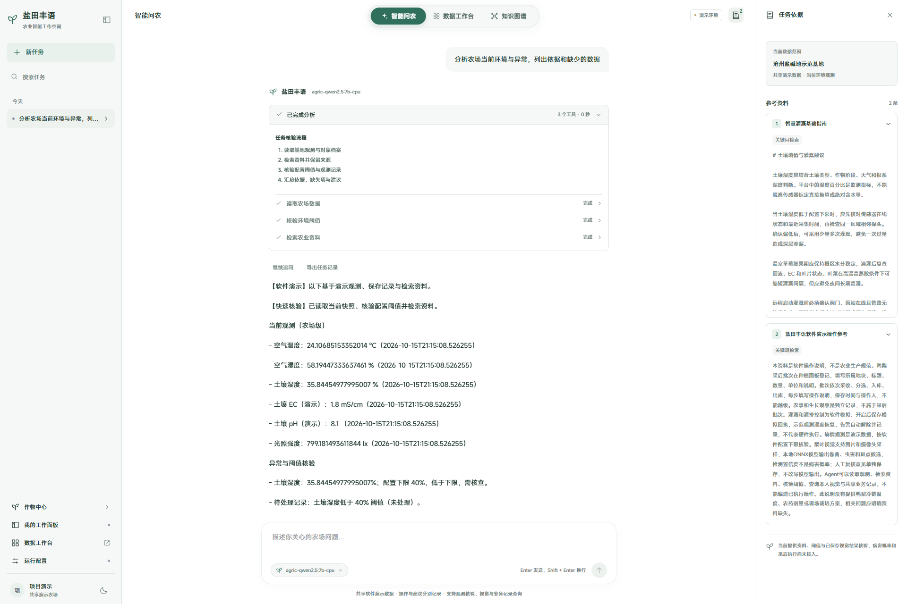
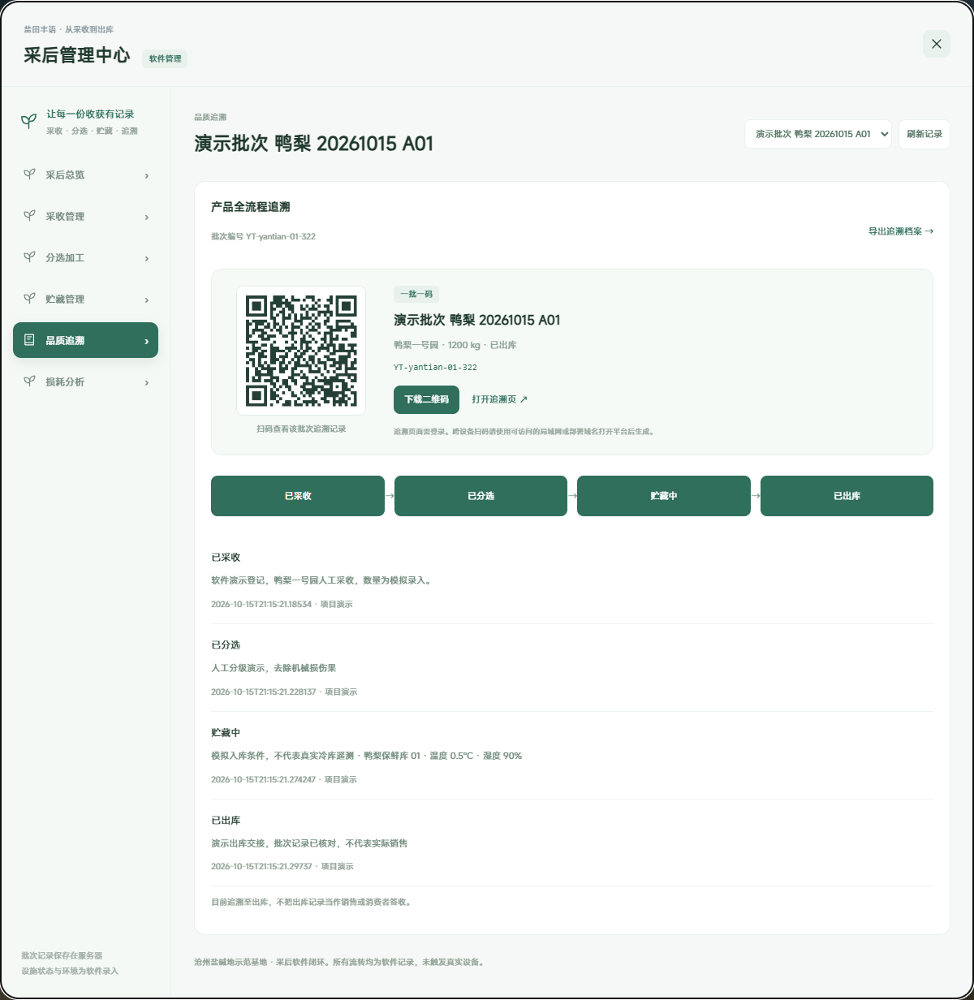

# 盐田丰语农业软件平台技术文档

版本 2.1    更新日期 2026年10月16日    适用基线 番茄大棚与串口改造后的工作区代码

本文面向开发、算法、测试、部署与项目评审人员，完整说明盐田丰语从农业观测、Agent核验、多作物视觉与知识检索，到采后记录和自动运输仿真的软件实现。本文依据当前源码和完成度审计重写，取代旧版技术说明手册作为维护入口。

当前交付以可运行的软件展示为主，包含演示观测、模拟运输和登记业务记录。本轮新增番茄大棚逐株场景，以及面向自研固件的串口协议、网关与入库接口。界面运行、模型推理、独立准确率评估和硬件联调分别验收；目前未连接实体串口设备，Jetson尚未上板验收。

文中公式均为Word原生OMML数学对象，可使用Word公式编辑器修改；公式后的符号说明给出单位、参数和源码含义。图像坐标的“单位”不是米，风险演示指数不是疾病概率。

## 阅读索引

1 系统范围与架构

2 数据模型与接口

3 Agent内核与资源控制

4 知识图谱与证据检索

5 多作物视觉识别

6 观测与风险评估

7 采后管理与追溯

8 道路约束与全局导航

9 局部运动与避障

10 二维和三维同步表现

11 Windows构建与启动

12 Jetson推理部署

13 测试验收与性能

14 运维安全与演进

15 串口设备通信与数据入库

16 界面运行验证与截图

附录 源码定位与公式索引

## 1 系统范围与架构

平台由React官网、Vue主工作台、独立多作物前端、Spring Boot业务服务、官方Harness运行时、Python视觉与知识服务以及MySQL和Neo4j组成。浏览器经Java统一鉴权访问业务和多作物代理接口；Three.js在客户端渲染场景，后端负责记录和权威运输状态。

| 组件 | 当前技术 | 责任 |
| --- | --- | --- |
| 官网 | React 18与Vite | 品牌介绍 注册 登录 |
| 主工作台 | Vue 3 TypeScript Three.js 0.152.2 | Agent 数据 作物 2D与3D |
| 业务服务 | Java 17 Spring Boot 4.1.0 JPA | 鉴权 数据 任务 记录 运输 |
| Agent运行时 | DeepSeek Harness SDK 0.2.0-rc.2 | 工具循环与会话事件 |
| AI服务 | Python FastAPI ONNX Runtime Ultralytics | 视觉与知识检索 |
| 存储 | MySQL Neo4j 文件目录 | 业务状态 图谱 原图与模型 |

一次视觉知识任务的路径为：地块选择→确定作物和识别任务→上传或摄像头采样→Java鉴权代理→对应Python模型→视觉候选→知识实体匹配→图谱问题预填或循证问答。模型识别标签只是一条观察线索，不能跳过知识证据准入与人工复核。

运输路径为：设施侧栏打开导航弹窗→选择取送点与货物→合法路线预览→库存预留→车辆取货→确认或自动装货→交付→入库流水。2D和3D只是同一任务的两个显示端。当前运输账和采后批次账独立，尚无自动创建采后批次的桥接逻辑。

## 2 数据模型与接口

MySQL保存用户、农场资产、环境观测、告警、个人面板、Agent任务与事件、视觉任务与复核、业务记录和运输状态。Neo4j保存作物知识实体及带来源的关系。上传原图和模型文件位于文件系统，不由浏览器自行覆盖。

| 数据域 | 核心结构 | 约束 |
| --- | --- | --- |
| 业务记录 | operation_records | id version farmId entityId kind stage parentId quantity unit operatorName simulated |
| Agent | 任务与递增事件序号 | 用户隔离 当前基地 工具参数与结果留痕 |
| 视觉 | 任务 原图 结果 复核 | 模型版本与哈希保存 复核不覆盖原输出 |
| 运输 | transport_states JSON | 任务 库存 预留 流水 车辆 路网版本 |
| 观测 | farm_observations | 时间 来源 基地 指标 最新240条查询 |
| 图谱 | 节点与关系 | 来源 定位 证据等级 适用阶段 审核状态 |

业务记录使用JPA乐观锁version防止并发流转冲突。采后批次与事件通过parentId关联。共享演示基地的农事和设备记录可在登录用户之间共享，Agent与视觉历史按用户隔离；当前不是完整企业租户权限模型。运输服务的synchronized保护单Java进程内修改，不构成多实例分布式锁。

| 接口 | 用途 | 校验 |
| --- | --- | --- |
| GET /api/health | Java存活 | 不代表模型或Neo4j就绪 |
| GET /api/system/status | 业务与模型诊断 | 登录后访问 配置模型检查 |
| GET /api/farms/{farmId}/dashboard | 数据快照 | 当前基地 |
| GET /api/farms/{farmId}/observations | 观测历史 | 指标与数量约束 |
| /api/agent/runs | Agent任务与事件 | 登录用户拥有任务 |
| /api/vision/jobs | 视觉任务与复核 | 登录用户与基地 |
| /api/multicrop/{path} | 多作物代理 | 路径白名单 GET与POST |
| /api/farms/{farmId}/operations | 农事与采后记录 | 对象归属 数量 流转顺序 |
| /api/farms/{farmId}/transport | 状态 规划 任务 控制 | 当前仅yantian-01仿真 |

## 3 Agent内核与资源控制

默认使用官方Harness sdk-minimal profile，自有Java循环保留为legacy兼容路径。Java管理身份、基地上下文、任务队列和结果核验，Node子进程运行SDK。系统禁用shell工具，只注册农业白名单插件：get_farm_context、analyze_environment、retrieve_evidence、get_vision_records、get_business_records及query_crop_knowledge。工具执行仍由后端权限和参数校验约束。

任务按创建、排队、运行、完成或失败/取消管理，工具调用与结果保存为有序事件。重试创建关联任务，不声称从模型内部中断状态恢复；取消会回收子进程。最终答案先核对要求的工具是否实际调用，以及指定视觉记录和业务批次是否一致，缺失事实使用保存结果摘要纠正。

$$
T_{effective}=\min(900,\max(60,T_{configured}))
$$

式（1）：T为秒；Harness任务预算默认600秒，配置夹限60至900秒。超时看门狗另留20秒回收余量。

式中，T为秒；Harness任务预算默认600秒，配置夹限60至900秒。超时看门狗另留20秒回收余量。

$$
N_{running}\le W\le C
$$

式（2）：W为执行线程数，C为任务容量。Windows默认W=2、C=4；上下文8192 token、单次生成上限768 token。Jetson计划为W=1、C=2、4096与512 token。

式中，W为执行线程数，C为任务容量。Windows默认W=2、C=4；上下文8192 token、单次生成上限768 token。Jetson计划为W=1、C=2、4096与512 token。

上下文投影在小预算配置下删除无关几何信息，保留实体ID、业务状态和指标；资料截断必须标记，完整工具结果仍保存为审计事件。服务端最终核验不能完全消除模型幻觉，仍需展示来源和不确定性。

快速环境总览匹配指定“分析农场当前环境与异常”问题，实际读取快照、核验配置阈值并检索资料后生成确定性摘要。2026年10月15日本轮截图已执行该路径，保存三个工具的过程与两条资料依据。该结果验证工具链和界面，不计作普通大模型生成式问答或响应速度验收；普通问题仍进入模型循环。

## 4 知识图谱与证据检索

多作物服务独立维护鸭梨、旱碱麦、金丝小枣和设施蔬菜知识范围。检查时节点/关系数分别为365/315、85/70、129/114和110/90；这些数量描述数据库内容，不代表全部知识通过地方专家验证。图谱显示直接查询Neo4j，不用假关系替代连接失败。

GraphRAG链路为问题路由、结构化实体提取、规范实体对齐、图子图与向量文档双通道召回、证据准入、排序融合和有来源回答。图路径候选最长三跳，枚举最多100条、访问状态最多10000，防止组合爆炸。路径存在只证明知识库记录了关系，不证明当前地块因果关系成立。

$$
E_{accepted}=\{e\in E_{candidates}\mid A(e,q)=1\}
$$

式（3）：A为证据准入规则，检查作物、区域、阶段、器官、来源定位、证据等级和审核状态；不满足准入的候选不得因相关性高而重新入选。

式中，A为证据准入规则，检查作物、区域、阶段、器官、来源定位、证据等级和审核状态；不满足准入的候选不得因相关性高而重新入选。

文档要求可定位来源，排除布局待复核内容；图路径要求边的evidence_ids、locator与已读取来源，检查审核状态和阶段转换。research模式可展示待迁移研究证据并告知限制，strict模式更严格约束适用范围。

$$
s_{lex}=\frac{|B(q)\cap B(d)|}{\max(1,|B(q)|)}
$$

式（4）：B为字符二元组集合。缺少重排权重或显式baseline模式时按此分数排序，分数不是神经重排概率。

式中，B为字符二元组集合。缺少重排权重或显式baseline模式时按此分数排序，分数不是神经重排概率。

$$
R_i=\frac12\left(\frac{k+1}{k+r_i}+\frac{k+1}{k+v_i}\right)
$$

式（5）：ri为重排或基线序号，vi为文档向量检索序号；图路径没有独立向量序号时vi取ri。当前k=60。

式中，ri为重排或基线序号，vi为文档向量检索序号；图路径没有独立向量序号时vi取ri。当前k=60。

$$
S_i=R_i\left[1-\alpha+\alpha\frac{M_i+Q_i}{2}\right]
$$

式（6）：Mi为非空适用范围匹配值中的最小值，缺省1；Qi为最弱证据等级权重，A=1、B=0.7、C=0.4，未知0；α默认0.10。

式中，Mi为非空适用范围匹配值中的最小值，缺省1；Qi为最弱证据等级权重，A=1、B=0.7、C=0.4，未知0；α默认0.10。

融合后按分数降序截取5至10条；没有强制图谱配额。参数尚未独立验证集调优，排序分数不应展示为答案真实性概率。问答依赖模型服务，图谱能展示不意味着生成式问答可用。

## 5 多作物视觉识别

模型由地块作物和识别对象选择。梨包括公开叶片检测及分支症状分类；麦包括叶部类别、水分胁迫和麦穗检测；枣包括叶部、碰伤和新鲜度。本轮从多作物分支提取番茄叶片分类与果实成熟度两份冻结V1权重，接入主工作台视觉组件、Java路径白名单和统一Python服务。独立多作物页的设施蔬菜入口仍以知识服务为主；其旧版健康字段不能代替番茄专用健康接口。

梨叶ONNX管线先校验模型SHA-256，应用EXIF方向并转RGB。图片超过2000万像素拒绝；最短边小于128、平均亮度低于15或高于245、灰度标准差小于5时进入需复核状态。此质量规则是低成本筛选，不是完整清晰度或病斑可见性模型。

$$
r=\min(640/W,640/H)
$$

式（7）：W、H是原图像素宽高；输入为640×640，缩放保持宽高比例，剩余区域以RGB(114,114,114)填充。

式中，W、H是原图像素宽高；输入为640×640，缩放保持宽高比例，剩余区域以RGB(114,114,114)填充。

$$
X_{input}=\operatorname{transpose}(I_{padded})/255
$$

式（8）：输入形状为1×3×640×640的连续float32 NCHW数组。填充偏移取整，缩放后尺寸round。

式中，输入形状为1×3×640×640的连续float32 NCHW数组。填充偏移取整，缩放后尺寸round。

$$
c_i=\arg\max_k z_{ik},\quad s_i=\max_k z_{ik}
$$

式（9）：固定YOLOv8输出为[1,4+C,N]，该导出没有独立objectness；si直接取类别最高分，默认门限0.55。

式中，固定YOLOv8输出为[1,4+C,N]，该导出没有独立objectness；si直接取类别最高分，默认门限0.55。

$$
\operatorname{IoU}(A,B)=\frac{|A\cap B|}{|A|+|B|-|A\cap B|}
$$

式（10）：按分数稳定排序，只抑制同类IoU≥0.45的框；异类框保留，最多返回50个有效框，分母用1e−8防止除零。

式中，按分数稳定排序，只抑制同类IoU≥0.45的框；异类框保留，最多返回50个有效框，分母用1e−8防止除零。

$$
x_{original}=\operatorname{clip}((x_{padded}-left)/r,0,W)
$$

式（11）：y同理使用top和H；框从中心宽高转为角点，再反缩放到原图。无有效检出返回NEEDS_REVIEW，不能判定健康。

式中，y同理使用top和H；框从中心宽高转为角点，再反缩放到原图。无有效检出返回NEEDS_REVIEW，不能判定健康。

Python常驻工作进程一次加载模型和会话，逐请求返回随机请求ID、模型哈希、后端类型、耗时和候选框。Java验证请求ID，处理EOF与超时后销毁工作进程，下次请求重建。连续摄像头采样等待上一帧完成，再间隔5秒，不堆积实时视频帧。关闭弹窗、切换输入或进入后台释放摄像头轨道。

视觉候选按标签和作物范围关联知识实体，预填鉴别条件和补充观测问题，没有匹配时明确提示。本轮数据工作台梨叶样例实际返回“虫害损伤（slug）”，显示关联知识记录及对应问题，供用户继续检索或交给Agent核验。人工复核独立保存，不覆盖模型原输出；分类置信度不等于地方准确率或疾病概率。番茄两份真实权重已通过加载、SHA256校验和推理接口检查，外部评估图片集与在线循证诊断仍需独立验收。

## 6 观测与风险评估

观测保存基地、指标、采样时间和来源。除自动演示与人工模拟记录外，本轮串口接口可接收经过校验的真实设备遥测并写入farm_observations，source记录为serial与设备ID；真实通信记录在设施侧栏独立展示，农场总览继续保留演示口径。历史接口最多返回240条，不补造过去记录；农场级观测不能代替每块地或每株作物独立测量。

$$
I_{low}=\mathbf1[m_{observed}<m_{minimum}]
$$

式（12）：1[条件]为指示函数。低于配置下限会提示复核，不自动证明缺水，也不直接执行真实设备。

式中，1[条件]为指示函数。低于配置下限会提示复核，不自动证明缺水，也不直接执行真实设备。

$$
R_{plot}=\min(100,20+20A+25\mathbf1[V>0])
$$

式（13）：A为未处理地块告警数，V为最近有结果视觉记录的候选数量。这是当前关注指数公式，非概率模型。

式中，A为未处理地块告警数，V为最近有结果视觉记录的候选数量。这是当前关注指数公式，非概率模型。

$$
R_{simulation}=\max(0,R_{plot}-8u_1-5u_2-7u_3)
$$

式（14）：u1、u2、u3分别为视觉复核、通风/水分核验及分选贮藏核验是否选中，取0或1。扣分仅用于界面方案比较。

式中，u1、u2、u3分别为视觉复核、通风/水分核验及分选贮藏核验是否选中，取0或1。扣分仅用于界面方案比较。

当前低关注小于40、中关注40至64、高关注至少65。所谓因果与证据页面是观测和知识关系展示，不是通过干预数据识别因果效应。方案保存为农事记录，不自动执行设备。未来预测风险需要时序数据、独立验证和校准，不能把上述公式改名为AI病害概率。

## 7 采后管理与追溯

采后中心提供总览、采收、分选、贮藏、品质追溯与损耗管理。批次必须关联所属地块，数量大于零；流转按采收、分选、入库、出库顺序执行，每一步保存操作人、时间和说明。乐观锁与状态校验防止重复和越级流转。不同单位分别汇总，公斤与件不直接相加。

$$
L_{batch}=\frac{\sum q_{loss}}{q_{harvest}}\times100\%
$$

式（15）：仅汇总该批次、同单位已登记损耗；没有损耗记录时显示未登记，不视为零。当前按一位小数展示。

式中，仅汇总该批次、同单位已登记损耗；没有损耗记录时显示未登记，不视为零。当前按一位小数展示。

QRCode库生成应用内批次追溯链接，链接带postharvest=trace及batch ID。二维码不是截图拼贴；目标仍需可访问应用并满足登录条件。localhost链接仅本机有效，外部扫码展示必须配置可达服务地址与适当访问控制。出库不等于销售或消费者签收。

$$
Q_{free}=Q_{stock}-Q_{reserved}
$$

式（16）：运输建任务先检查未预留库存，随后增加reserved。装货时同时减少stock与reserved，卸货增加目的地stock并写INBOUND流水。

式中，运输建任务先检查未预留库存，随后增加reserved。装货时同时减少stock与reserved，卸货增加目的地stock并写INBOUND流水。

运输库存与采后批次当前尚未联动。完整软件闭环应增加批次或物料ID、库位、运输单和幂等事件键，由卸货提交业务入库事件；运输失败需补偿预留和状态，避免一个模块成功另一个失败。本文将其列为后续工程，不描述为当前能力。

## 8 道路约束与全局导航

地图交互和导航仍使用1536×1024逻辑坐标，v6路网含24条批准路段与23个服务节点。当前资产类型为field或greenhouse的地块均参与禁行区检查，番茄大棚不会因类型变更而被运输规划忽略。路线连接道路边缘装卸点；底图为AI概念画面，坐标未经过GIS测绘。

$$
t=\operatorname{clip}\left(\frac{(p-a)\cdot(b-a)}{\|b-a\|^2},0,1\right),\ d=\|p-a-t(b-a)\|
$$

式（17）：d为点到线段最短距离；零长度线段直接取点距离。禁区包含检查用射线交叉奇偶规则。

式中，d为点到线段最短距离；零长度线段直接取点距离。禁区包含检查用射线交叉奇偶规则。

$$
d(\mathrm{segment},\mathrm{keepout})>R_{safe}
$$

式（18）：车辆半径R=5图像单位；整个道路走廊合法性使用半宽8。检测端点、边相交和线段最小距离，边界接触也不通过。

式中，车辆半径R=5图像单位；整个道路走廊合法性使用半宽8。检测端点、边相交和线段最小距离，边界接触也不通过。

$$
d(p,\mathrm{road})\le8-5=3
$$

式（19）：局部运动中心必须留在道路中心线3单位范围内，确保车身仍在16单位宽走廊内；全局道路同时每3单位采样复核。

式中，局部运动中心必须留在道路中心线3单位范围内，确保车身仍在16单位宽走廊内；全局道路同时每3单位采样复核。

$$
f(n)=g(n)+h(n),\quad h(n)=\sqrt{(x_n-x_g)^2+(y_n-y_g)^2}
$$

式（20）：g为累积欧氏路段长度，h为到目标的欧氏距离。只扩展未封闭且安全的边；该启发式对当前欧氏路网可采纳。

式中，g为累积欧氏路段长度，h为到目标的欧氏距离。只扩展未封闭且安全的边；该启发式对当前欧氏路网可采纳。

A*通过cost、parent和visited保存状态，扫描开放节点选择最小f，再由parent回溯路线。当前小图使用扫描方式，不能引用优先队列实现的复杂度作为源码实测。无合法路径拒绝创建任务；已在节点且路段受阻可重新规划，在路段中受阻优先停车，不能直接切到旁边田地。

## 9 局部运动与避障

局部控制是受限DWA式速度采样，不是完整ROS Nav2导航栈。每500ms后台更新，时间步限制为0至1秒。候选线速度为0、12、24、36、48图像单位每秒，并依据剩余距离截断；角速度为−1.5、−0.75、0、0.75、1.5弧度每秒。每对速度进行五次子步预测。

$$
v\le\min(48,v_{current}+24\Delta t)+0.01
$$

式（21）：24为加速上限的当前代码参数，0.01为比较容差；没有完整制动距离约束或角加速度窗口。

式中，24为加速上限的当前代码参数，0.01为比较容差；没有完整制动距离约束或角加速度窗口。

$$
\theta_{j+1}=\theta_j+\omega\delta t,\quad x_{j+1}=x_j+v\cos\theta_{j+1}\delta t
$$

式（22）：δt=Δt/5；y更新同理使用sin。实现先更新航向再更新位置，公式保持该离散顺序。

式中，δt=Δt/5；y更新同理使用sin。实现先更新航向再更新位置，公式保持该离散顺序。

$$
J(v,\omega)=d(p_{end},goal)+2|\omega|-0.02v
$$

式（23）：从通过道路、禁区和障碍约束的候选中取J最小者。系数为演示控制权重，不是独立调优结果。

式中，从通过道路、禁区和障碍约束的候选中取J最小者。系数为演示控制权重，不是独立调优结果。

$$
\|p-o\|>r_{obstacle}+5+2
$$

式（24）：2为障碍额外安全距离；预测每一子段连续检查田地扫掠，障碍使用圆形距离以及外层运动段检测。默认障碍半径12。

式中，2为障碍额外安全距离；预测每一子段连续检查田地扫掠，障碍使用圆形距离以及外层运动段检测。默认障碍半径12。

路口先限幅调整航向，角度偏差超过0.15弧度时继续转向而不推进位置。所有候选不可行或最优速度为零时BLOCKED。动态障碍按服务路横向往返运动，若其下一段与车包络过近会回退偏移并改变方向；它不是感知到的真人轨迹预测。

任务状态包括QUEUED、RUNNING、PAUSED、BLOCKED、WAIT_LOAD、WAIT_UNLOAD、COMPLETED和CANCELLED。自动装卸等待2秒后执行；急停禁止推进与交接，解除急停后仍需恢复任务。返航和空载巡航不改变库存。电量、充电和载荷均为软件参数，单任务上限500登记单位不等于真实额定载重。

## 10 二维和三维同步表现

服务端坐标、航向和lastTick是权威源，两个视图共用TransportPlayback。前端每250ms可能取得重复快照，重复key不会重新开始动画；按服务端时钟对齐快照，使用800ms播放缓冲抵抗网络到达抖动。

$$
u=\operatorname{clip}\left(\frac{t-800-t_a}{t_b-t_a},0,1\right)
$$

式（25）：时间以毫秒计，ta、tb是对齐后的邻近快照；同一路段按长度插值，跨一个路口沿公共节点分段插值。

式中，时间以毫秒计，ta、tb是对齐后的邻近快照；同一路段按长度插值，跨一个路口沿公共节点分段插值。

$$
\theta(u)=\theta_a+u\operatorname{atan2}(\sin(\theta_b-\theta_a),\cos(\theta_b-\theta_a))
$$

式（26）：航向采用最短角差避免跨±π转整圈。地图更换、急停和无法确认的跨路段运动直接恢复确认位置，不外推穿田路线。

式中，航向采用最短角差避免跨±π转整圈。地图更换、急停和无法确认的跨路段运动直接恢复确认位置，不外推穿田路线。

$$
\Delta\phi=\Delta s/r_{wheel}
$$

式（27）：这是轮组滚动的几何关系；轮相位来自运动距离，转向及原地转动使用左右轮差，停止时不继续滚动。

式中，这是轮组滚动的几何关系；轮相位来自运动距离，转向及原地转动使用左右轮差，停止时不继续滚动。

2D使用透明多角度图片，画布显示车身转向、轮毂滚动与方向帧过渡。图片中的箱子为示意，不完全表达空载内容。3D使用真实程序化几何、独立转向轮组和货物显隐，车长约2.08、宽1.47、高1.06世界单位，固定比例不随地图位置改变。

imageToGround将逻辑底图坐标转换到园区地面，3D使用局部前向映射计算航向。鸭梨二号园保留yt-pear-02并改为番茄大棚，整体场景显示拱棚、作物行与吊蔓；内部四床八行共32株，每株具有稳定编号和演示档案。支持点选、近距离观察、WASD巡检和畦床碰撞约束。实景使用生成的单张宽幅农田底图，支持拖拽、滚轮缩放和边缘限制；概念画面不构成测绘结果。

## 11 Windows构建与启动

源码环境要求JDK 17及以上、Node 24及以上、Python 3.11、Docker Desktop和兼容模型服务。start.cmd调用scripts/main.ps1，读取未跟踪的.env.local，初始化数据库，安装Agent、视觉与多作物依赖，构建landing、frontend、vision-frontend，再启动Spring Boot。已经安装依赖时可使用-SkipBuild，不能把它用于全新安装。

当前MySQL展示容器为agric-mysql，映射3307；不要默认连接其他项目的3306数据库。Neo4j默认本机7474，多作物Python默认127.0.0.1:8090，Java主程序8081。端口、密码、JWT密钥和模型地址由私有配置提供，文档不携带真实凭据。

MultiCropRuntime在应用就绪及请求前检查本机服务，15秒监督一次，子进程退出后按冷却时间重启。仅管理本机HTTP配置，远程地址复用不拉起本地进程。默认Neo4j容器存在且停止时可docker start；首次容器创建与知识初始化仍由setup-multicrop负责，监督器不替代首次安装。

知识页面使用有上限重试，约75秒总预算，切换作物或卸载页面取消旧请求。401/403/404等不作无限重试。运行诊断必须同时检查Java、数据库、配置模型、权重、Neo4j及Python，不能用/api/health的UP替代整个系统健康。

构建顺序为三个前端npm ci与npm run build，再mvnw.cmd test和mvnw.cmd package。scripts/create-release.ps1与scripts/create-jetson-release.ps1复制指定JAR，默认不重建，也默认不包含多作物；完整包必须加-IncludeMultiCrop并检查模型与图谱数据。审计时已有JAR仍是10月12日版本，不能当作本技术基线最新包。

## 12 Jetson推理部署

展示选型为Jetson Orin Nano Super 8GB、主动散热和256GB NVMe。计划基线固定JetPack 6.2.1、L4T 36.4.4、Ubuntu 22.04 ARM64、CUDA 12.6和TensorRT 10.3。这是部署文档的适配目标，不是本项目已完成的实机兼容报告。浏览器优先在桌面端运行以减少共享内存竞争。

计划本地模型为Qwen3 4B Q4_K_M，llama.cpp按SM87构建，控制上下文、生成量和并发。模型文件约2.5GB不等于总内存占用；KV缓存、Java、数据库、Neo4j、多作物权重和系统都共享8GB。缺少模型或板端内存数据时不能填写估计吞吐量作为结果。

梨叶TensorRT路径固定输入形状、显式IO、复用CUDA流和缓冲区。Jetson 可选 CUDA fused letterbox/质量统计、CUDA 候选解码与 NMS、nvImageCodec JPEG GPU 解码；默认仍是 Pillow 解码和 CPU 后处理，Windows 默认 ONNX Runtime CPU。GPU 开关只适用于 TensorRT，并需以 CPU/Pillow 为基线逐框验收。FP16引擎必须在目标板构建，记录ONNX及引擎哈希、TensorRT版本。显式选择TensorRT失败应报错，不把CPU回退冒充GPU执行。当前没有INT8校准、CUDA Graph或零拷贝CSI摄像头解码实现；本次新增 GPU NMS 和 nvImageCodec 路径尚无 Jetson 编译、运行和性能数据。

$$
T_{total}=T_{decode}+T_{pre}+T_{copy}+T_{infer}+T_{post}
$$

式（28）：当前流水线记录图片解码、预处理、推理、后处理及总耗时；这些计时用于定位阶段瓶颈，不能单独拆分每次 CUDA 复制时间，需结合 Nsight 和板端补测。

式中，$T_{decode}$、$T_{pre}$、$T_{infer}$、$T_{post}$ 分别对应 `imageDecodeMs`、`preprocessMs`、`inferenceMs`、`postprocessMs`。总时延还包含请求编排和结果格式化，分段计时存在同步与调度开销。

$$
\operatorname{IoU}(B_{CPU},B_{GPU})\ge0.9,\quad |s_{CPU}-s_{GPU}|\le0.03
$$

式（29）：CPU与GPU比较要求类别一致，并使用上述框和置信度阈值。数值一致性不等于诊断准确率。

式中，CPU与GPU比较要求类别一致，并使用上述框和置信度阈值。数值一致性不等于诊断准确率。

现有install-services.sh只启用agric和agric-llama，未安装启用agric-multicrop.service；Compose只有MySQL，未包含Neo4j。全功能Jetson部署还需要补齐多作物服务、持久目录与权限、Python ARM64依赖、全部权重兼容与启动顺序。未完成这些内容之前，不承诺开机即具备全部图谱与视觉功能。

## 13 测试验收与性能

| 测试层 | 验证证据与日期 | 解释 |
| --- | --- | --- |
| Java | 47项通过 无失败与跳过 | 独立tianyan_test，不操作演示库 |
| 运输前端 | 15项Node测试通过 | 方向 轮子 缓冲 模型与货物 |
| Harness | 5项Node测试通过 | 工具schema与快速路径 预算 |
| 视觉 | 3项Python测试通过 | 真实ONNX常驻进程与恢复 |
| 检索排序 | 2项pytest通过 | PYTHONPATH需ai-service |
| 浏览器 | 主路由桌面1440与手机390检查 | 无脚本错误与页面横向溢出 |
| 图谱 | 四作物实际读取正常 | 不替代模型问答验收 |
| 3D运输 | 真实规划 隔离写入检查通过 | 不宣称本轮实际库存全流程交付 |

本轮相关后端回归20项通过，覆盖设备遥测与回执、场景校准、运输几何、运输流转及多作物代理；串口Python测试8项通过，C编解码通过CRC、坏帧恢复与跨语言黄金报文检查。前端类型检查、构建及浏览器检查通过，32株档案可选。验证范围按测试集记录，未将历史47项回归与本轮20项相加为新的全量结果。

$$
Precision=TP/(TP+FP),\quad Recall=TP/(TP+FN)
$$

式（30）：这是建议模型评测指标，不是已取得结果。需冻结测试集、明确类别与IoU匹配门限，避免同株或相邻视频帧跨训练与测试泄漏。

式中，这是建议模型评测指标，不是已取得结果。需冻结测试集、明确类别与IoU匹配门限，避免同株或相邻视频帧跨训练与测试泄漏。

分类应按类别报告混淆矩阵、准确率及F1；检测应报告mAP、召回与漏检，水分胁迫还需明确标签来源。置信度可校准性应独立评估。当前没有支持鸭梨地方独立诊断或全作物统一精度承诺的完整验收报告。

性能报告需记录设备、功耗模式、温度、版本、模型哈希、分辨率、暖机与冷启动、样本数和并发。建议板端连续两小时无OOM、视觉暖机p95≤500ms、Agent单任务≤180秒均为待验收目标；不得写成已有实测。一般问答还应分别记录首token、总耗时、工具耗时和失败率。

## 14 运维安全与演进

密钥和数据库密码只放私有环境配置，发行包不得复制本地token、runtime.json中的秘密或用户数据。模型代理采用路径白名单，本机AI端口绑定回环；异机摄像头采样需可信HTTPS。当前共享演示权限应与生产租户权限区分，正式发行前要补基地成员授权、角色及审计。

备份涵盖数据库和视觉原图并带SHA-256清单，备份前暂停写入，恢复到新空库与新目录，不覆盖运行库。当前Hibernate ddl-auto=update，跨版本回滚不能只换JAR；必须匹配数据库快照，后续引入版本化迁移。日志需要轮转，状态数据和模型文件需明确可写目录与备份责任。

商业发行要整理原软件、公开权重、训练样本和生成素材的来源与许可，包含梨叶上游和Ultralytics AGPL相关文件。文档中的许可说明是工程清单，不替代对具体发行形式的审查。无需真实硬件展示并不意味着可以省略软件依赖与许可证交付。

下一阶段优先完成具体设备型号、厂家协议与电气接口确认，开展固件烧录、串口断线与执行器联调；补充番茄独立评估集、其他设施蔬菜模型，以及普通模型问答和Jetson实机验收。运输与采后批次的自动联动、版本化迁移、租户权限和持续集成仍需后续工程。真实SLAM、ROS2实车导航和真实风险预测属于新增范围。

## 15 串口设备通信与数据入库

TY Serial v1面向自研固件，包含CRC16帧、Python持久化网关、C编解码器和模拟固件。默认115200 8N1，载荷不超过2048字节，帧类型为遥测、指令、回执及预留HELLO。真实设备的电气接口和厂家协议仍需确认。

遥测经过SQLite离线缓存、消息去重、指标与采样时间校验后，事务写入farm_observations；来源为serial与设备ID。指令使用requestId幂等创建，网关2秒重试、最多3次，60秒过期；收到成功回执后才更新设备状态。接口仍沿用JWT与共享基地授权口径。

支持采样、自检、开关、档位和停止，设备端需实现定时关闭、最大运行时间与看门狗。完整报文、单位范围、配置与联调说明见[串口接入文档](../embedded/README.md)。现有厂家Modbus或私有寄存器协议、固件烧录和实机串口联调未完成。

## 16 界面运行验证与截图

截图1于2026年10月16日从数据工作台地块详情重新截取；截图2、3保留2026年10月15日运行结果。使用独立tianyan_test数据库，不修改页面文本或伪造接口返回。

### 截图1 多作物研判与梨叶症状识别结果

数据工作台选中鸭梨一号园，打开地块详情的“病虫害识别”页，使用示范图片调用真实梨叶分类权重，返回“虫害损伤”候选及识别分数。页面同时展示四项关联知识图谱记录，以及可继续检索和交给Agent核验的问题。分数仅表示模型对视觉类别的置信，不代表疾病概率或虫种确诊。

### 截图2 智能问农的任务执行过程与证据展示

实际问题为“分析农场当前环境与异常，列出依据和缺少的数据”。任务记录三个完成的工具步骤，证据栏展示两条关键词检索资料。该任务走已实现的环境快速核验路径，验证数据读取、阈值核验、资料展示与事件留痕，不作为普通大模型问答验收。

### 截图3 采后批次登记与追溯链路

批次“演示批次 鸭梨 20261015 A01”登记1200 kg，关联鸭梨一号园，按采收、分选、入库和出库顺序写入事件。界面显示批次编号、二维码、阶段和登记说明。数量、分级和库温为模拟录入，二维码目标需要登录并能访问当前服务，出库记录不代表真实销售。

## 附录 源码定位与维护入口

| 领域 | 源码位置 | 核对内容 |
| --- | --- | --- |
| Agent | src/main/java/com/example/ty/agent 与 agent-runtime | 工具 预算 事件 结果核验 快速总览 |
| 图谱 | ai-service/graphrag 与 ai-service/graph_web | 准入 双召回 排序 问答 |
| 视觉 | vision-runtime/pipeline.py 与 tensorrt_backend.py | 缩放 NMS 常驻推理 GPU IO |
| 作物视觉 | frontend/src/components/workspace/CropVisionWorkbench.vue | 地块权重与图谱问题 |
| 风险 | frontend/src/components/workspace/FarmRiskCenter.vue | 固定规则与方案扣分 |
| 采后 | PostHarvestCenter.vue 与 Java operations | 二维码 批次 乐观锁 流转 |
| 导航 | src/main/java/com/example/ty/transport/TransportService.java | 路图 几何约束 A* DWA 库存 |
| 同步 | transportPlayback.ts transportMotion.ts transportScene.ts | 合法分段插值 轮子 3D映射 |
| 启动 | scripts/main.ps1 scripts/setup-multicrop.ps1 MultiCropRuntime.java | 安装 初始化 进程监督 |
| Jetson | deploy/jetson 与 docs/Jetson部署与验收.md | 目标栈 脚本与未验收范围 |

源码与验证说明以2026年10月15日当前工作区为基准。原生Word公式（1）至（30）完整保留，涵盖预算、检索、视觉、风险、损耗、库存、几何、规划、运动、显示和验收。新增串口与大棚实现见embedded/README.md及docs/番茄大棚与串口改造.md。

参考入口：docs/项目完成度审计_2026-10-14.md、docs/WJM分支分析与接入.md、docs/自动导航运输系统.md、docs/Jetson部署与验收.md、docs/软件演示交付检查.md。外部实现来源包括DeepSeek Harness SDK、Ultralytics YOLO、ONNX Runtime、NVIDIA TensorRT与llama.cpp；实际版本和哈希以锁文件、模型manifest和固定下载脚本为准。
